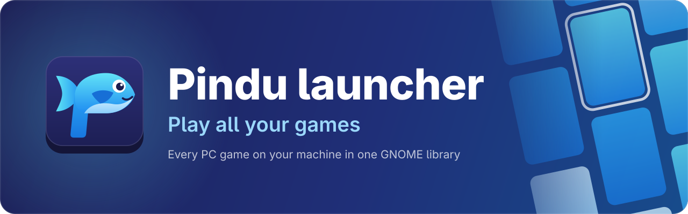
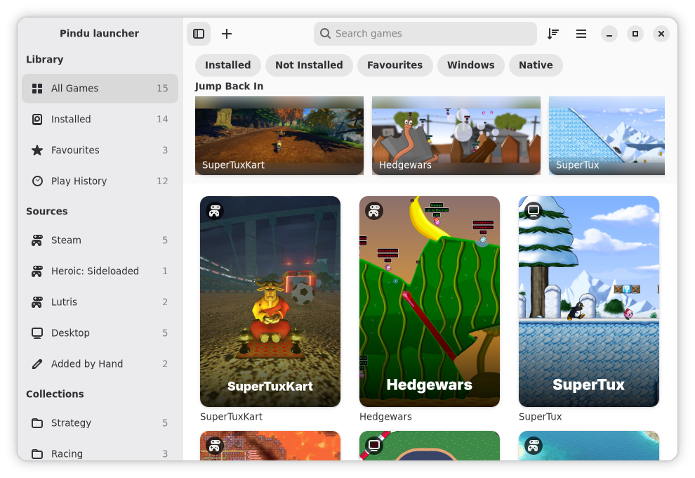
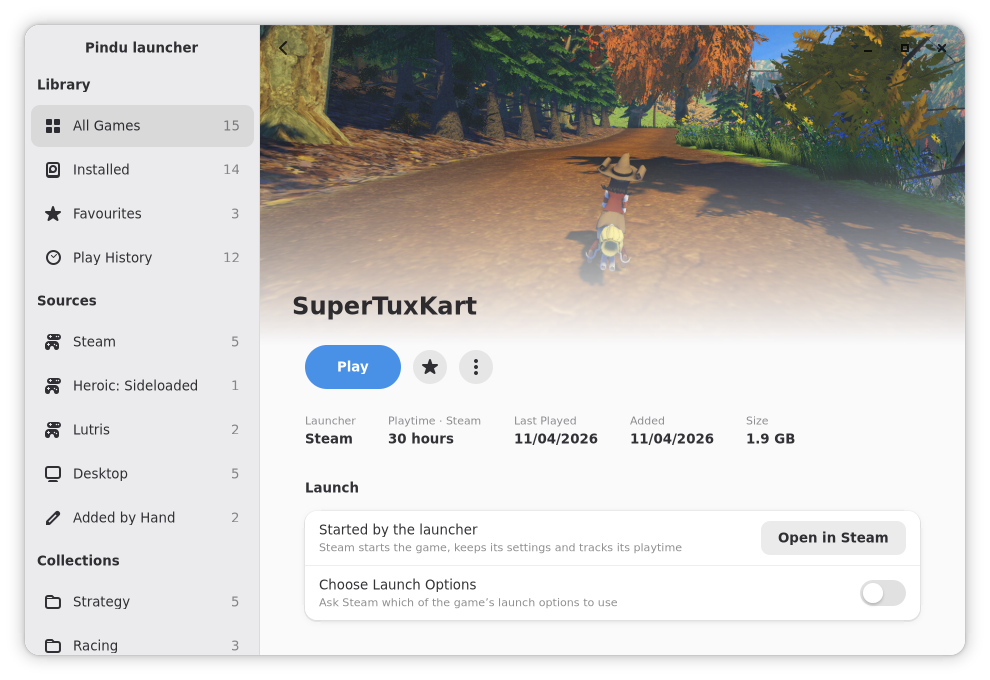
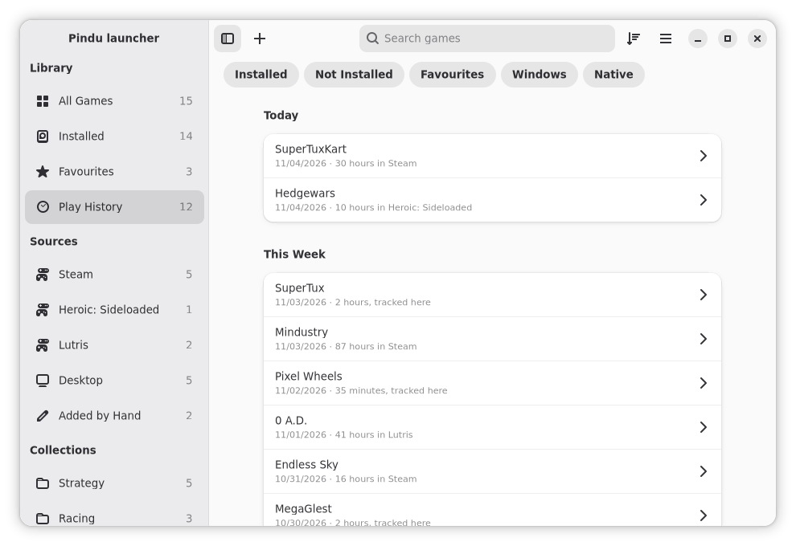
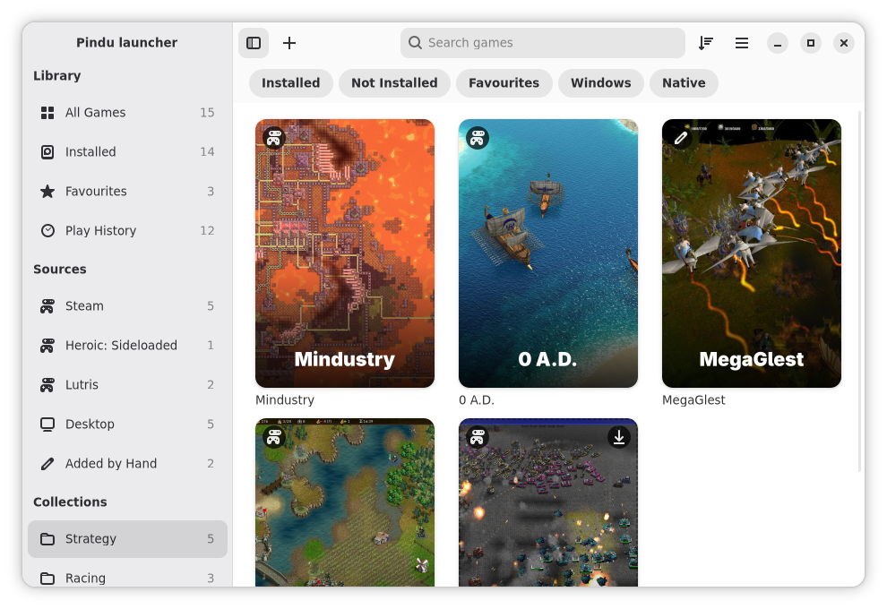
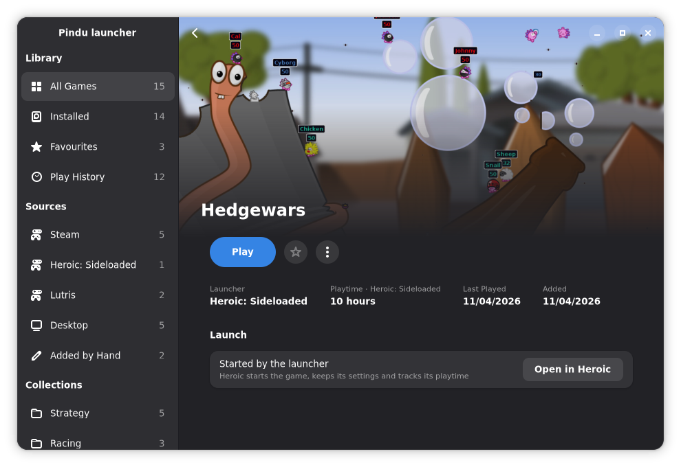
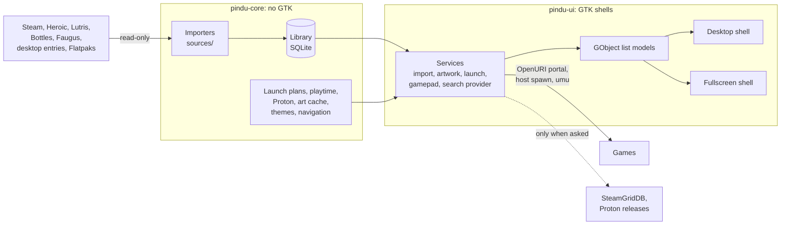

<div align="center">



[Install](#installing) · [Features](#features) · [Fullscreen mode](#fullscreen-mode) ·
[Report a bug](https://github.com/Tim-van-Oudheusden/pindu-launcher/issues/new) ·
[Roadmap](https://github.com/Tim-van-Oudheusden/pindu-launcher/milestones)

[](https://github.com/Tim-van-Oudheusden/pindu-launcher/actions/workflows/ci.yml)
[](https://github.com/Tim-van-Oudheusden/pindu-launcher/tags)
[](#building-from-source)
[](#installing)
[](#tech-stack)
[](LICENSE)
[](https://github.com/Tim-van-Oudheusden/pindu-launcher/commits/main)

</div>

<p align="center">
  
</p>

<p align="center">
  
  
  <br>
  
  
</p>

## Status

Early development. Releases ship on [GitHub Releases](https://github.com/Tim-van-Oudheusden/pindu-launcher/releases)
as a Flatpak bundle, with native packages for Fedora 45, Debian testing and Ubuntu 26.10 ([Installing](#installing));
a Flathub listing comes later. Linux only. Progress is tracked in the
[milestones](https://github.com/Tim-van-Oudheusden/pindu-launcher/milestones).

## About

Pindu launcher gathers every game on your computer into one library, whichever launcher installed it. Browse your
covers, pick up where you left off and start any game with one click, or switch to the fullscreen mode and do the same
from the couch with a controller. Both modes are views over the same library, built with stock GTK 4 and libadwaita
widgets so it looks and behaves like the rest of GNOME.

## Features

- **Every launcher, one library.** Steam, Heroic, Lutris, Bottles, Faugus, games installed as apps (Flatpaks included)
  and games you add yourself, side by side. The library resyncs when a launcher's files change.
- **Launchers stay in charge.** Store games start through their own launcher, which keeps their settings, updates and
  playtime. Pindu launcher only reads the launchers' files and never writes to them.
- **Windows games too.** Add a Windows game, or its installer, by hand and it runs with Proton through
  [umu](https://github.com/Open-Wine-Components/umu-launcher) in a prefix of its own. Download GE-Proton and
  Proton-CachyOS builds from Preferences, and turn on MangoHud or GameMode per game.
- **A fullscreen mode for the couch.** A controller-first Home, library and game pages, a Quick Access panel, an
  on-screen keyboard for search and navigation sounds, with switchable designs and your own CSS
  ([Fullscreen mode](#fullscreen-mode)).
- **A tidy library.** Search, sort and filter by installed, favourite, Windows or native. Group games into your own
  collections, jump back into recent games and hide the ones you never play.
- **Play history.** When you played and for how long, including the playtime your launchers recorded.
- **Your artwork.** Covers, banners and logos from your launchers, from your own files, or from
  [SteamGridDB](https://www.steamgriddb.com) with your own API key, which stays in the system keyring.
- **Search from GNOME Shell.** Type a game's name in the Activities overview to start it.
- **Offline and private.** The library works without a network. Pindu launcher goes online only for the artwork and
  Proton builds you ask for.
- **Backups.** Export your collections, favourites, hidden games, games added by hand and tracked playtime to a file,
  and import them again.

## Game sources

| Source | Games | How they start |
| --- | --- | --- |
| Steam, native or Flatpak | Installed games, with their playtime | Through Steam |
| Heroic, native or Flatpak | Epic Games, GOG, Amazon and sideloaded games, installed or not | Through Heroic |
| Lutris, native or Flatpak | Lutris games | Through Lutris |
| Bottles, native or Flatpak | Programs in your bottles | Through Bottles |
| Faugus Launcher, native or Flatpak | Faugus games | On the host ([needs host access](#starting-games-on-the-host)) |
| Desktop entries and Flatpaks | Games installed as apps | On the host ([needs host access](#starting-games-on-the-host)) |
| Added by hand | Native programs, and Windows games or installers | Native ones on the host; Windows ones with Proton in the sandbox |

The importers read each launcher's data read-only and never its credentials.

## Installing

Pick one:

- **Download a release.** Each [release](https://github.com/Tim-van-Oudheusden/pindu-launcher/releases/latest) has a
  `pindu-launcher-<version>-x86_64.flatpak` bundle and a `SHA256SUMS` file. The bundle needs the GNOME 51 runtime,
  which Flatpak installs from Flathub, so add the Flathub remote first:

  ```sh
  flatpak remote-add --if-not-exists --user flathub https://dl.flathub.org/repo/flathub.flatpakrepo
  flatpak install --user ./pindu-launcher-0.2.0-x86_64.flatpak
  flatpak run io.github.tim_van_oudheusden.pindu-launcher
  ```

  A bundle does not update itself: install the next release's bundle the same way.
- **Install a native package** on Fedora 45, Debian testing or Ubuntu 26.10, the distros with GTK 4.24 and
  libadwaita 1.10. Each release has `pindu-launcher-<version>-1.fc45.x86_64.rpm`,
  `pindu-launcher-<version>-debian-testing-amd64.deb` and `pindu-launcher-<version>-ubuntu-26.10-amd64.deb`; install
  the one for your system with `sudo dnf install ./<file>` or `sudo apt install ./<file>`. Native packages run without
  the Flatpak sandbox and do not update themselves, and Windows games need
  [umu-launcher](https://github.com/Open-Wine-Components/umu-launcher#installing), which these distros do not
  package.
- **Download a CI build.** Every CI run uploads a development bundle of the latest code as the
  `pindu-launcher-devel-x86_64.flatpak` artifact. Open a recent run of the
  [`CI` workflow](https://github.com/Tim-van-Oudheusden/pindu-launcher/actions/workflows/ci.yml) (you must be signed in
  to GitHub), download the artifact and unzip it. The bundle needs the GNOME 51 runtime, which Flatpak installs from
  Flathub, so add the Flathub remote first:

  ```sh
  flatpak remote-add --if-not-exists --user flathub https://dl.flathub.org/repo/flathub.flatpakrepo
  flatpak install --user ./pindu-launcher-devel.flatpak
  flatpak run io.github.tim_van_oudheusden.pindu-launcher-devel
  ```

  The development build has its own app ID and nightly icon, and installs beside a stable one.
- **Build from source.** See [Building from source](#building-from-source).

### Starting games on the host

Store games start through the OpenURI portal and always work. Games that start as a program on the host (desktop
entries, Flatpak games, Faugus games and native games added by hand) need the app to reach the host through
`org.freedesktop.Flatpak`, which Pindu launcher never asks for itself. Until you grant it, those games explain what is
missing instead of failing, and **Preferences → Permissions** shows the command:

```sh
flatpak override --user --talk-name=org.freedesktop.Flatpak io.github.tim_van_oudheusden.pindu-launcher
```

> [!WARNING]
> **This is a sandbox escape that you choose.** Access to `org.freedesktop.Flatpak` lets Pindu launcher run any
> command on your host as your user, outside the sandbox. Only grant it if you accept that.

Restart Pindu launcher afterwards. To take the access back:

```sh
flatpak override --user --no-talk-name=org.freedesktop.Flatpak io.github.tim_van_oudheusden.pindu-launcher
```

For the development build, use `io.github.tim_van_oudheusden.pindu-launcher-devel` in both commands.

## Fullscreen mode

Press <kbd>F11</kbd>, start the app with `--fullscreen`, or turn on **Start in Fullscreen Mode** in Preferences. Move
with the D-pad or left stick, open with A and go back with B; the hint bar at the bottom names the buttons that work on
each screen, drawn with the app's own glyphs for the controller you hold. Quick Access (right stick click, the Steam
Deck's "…" button, or <kbd>Ctrl</kbd>+<kbd>2</kbd>) shows the time, the battery and whether you are offline, the game you
are playing with how long it has run, and this session's notifications: games a sync added or found missing, artwork
fetched or not, Proton downloads and games that need a permission. It opens on them while one is unread. While a
library sync, a SteamGridDB artwork fetch or a Proton download runs, its Activity lists them with their progress and
cancels artwork fetches and Proton downloads (a cancelled download leaves nothing behind). **Refresh Library** reads
your launchers again, offline like every sync. **Surprise Me** opens the page of an installed game picked at random,
never the same one twice in a row, so you still choose whether to play. On the library page, **Filters** narrows every
tab to installed or not installed games, Windows or native ones, and can show hidden games too; a **Filtered** chip
beside the tabs says so, and **Clear Filters** brings the whole tab back. These filters are apart from the desktop
window's filter row and last until the app quits. With a game Pindu runs itself focused, or on its page,
**Performance** turns its **Performance Overlay** (MangoHud) and **GameMode** on or off from its next launch, the same
switches its options sheet (View or X) has; store games, whose launcher keeps their settings, have neither, and while
the game runs the level says a change waits for its next start. Quick Access also switches the design and holds quick
settings: cover size, navigation sounds with a volume slider that left and right turn (here or in Preferences),
exiting after a launch, and under Accessibility **Reduce Motion** (Home's background holds still and art changes
without a fade, as it also does when the system's animations are off) and **Larger Text** (fullscreen text about a
quarter larger). **Controllers** lists the controllers it sees, with the glyphs each shows and its battery where
the system reports one for it; select one to make it rumble, so you can tell which is which. There, or in Preferences,
**Button Prompts** picks the glyphs (letters, shapes or letters with A on the right) instead of following the
controller, which helps under Steam Input, where every controller looks like Steam's own, and **Swap Confirm and Back**
makes the right button confirm and the bottom one go back everywhere in fullscreen mode. **Controls** lists everything
the buttons do, in groups (moving, the library, the panels and launching), with the glyphs of the controller in use and
the keys that do the same, including the ones the hint bar leaves out, such as holding B to cancel a launch; without a
controller it lists the keys alone.

### Running in gamescope

For a couch setup, run the fullscreen mode inside [gamescope](https://github.com/ValveSoftware/gamescope):

```sh
gamescope -f -- flatpak run --nosocket=wayland io.github.tim_van_oudheusden.pindu-launcher --fullscreen
```

- The app runs as an X11 client on gamescope's Xwayland, and its window fills gamescope's screen. A game window that
  opens takes gamescope's focus, and the app gets it back when the game quits.
- `--nosocket=wayland` matters when gamescope starts from a desktop session: without it, Flatpak gives the app the
  desktop's Wayland display, and the window opens on the desktop instead of in gamescope.
- `-f` makes gamescope's window fullscreen when it runs nested in a desktop session.
- Under X11 the app draws at scale 1. On a 4K screen, let gamescope upscale a smaller picture
  (`gamescope -W 3840 -H 2160 -w 1920 -h 1080 -f -- …`) or scale the app (`flatpak run --env=GDK_SCALE=2 …`).
- `--expose-wayland` is not recommended. The app then runs as a Wayland client, but gamescope doesn't make its window
  fullscreen: the window keeps its desktop size, and gamescope scales it up to the screen.

### Styling fullscreen mode

Fullscreen mode has switchable designs (Quick Access → Design): Ribbon, the default, and Panorama ship with the app,
and Adwaita shows the standard libadwaita look. A design can come in variants, such as Panorama's Monochrome, picked
under the design. The same level blurs and dims Home's background (Off, Low or High each) and turns **My Stylesheet**,
your own CSS, on and off. Where the files go, the `theme.json` fields and the CSS names designs can rely on are in
[`docs/fullscreen-style.md`](docs/fullscreen-style.md).

## Building from source

The build needs GTK 4.24, libadwaita 1.10, libmanette 0.2.10, blueprint-compiler, Meson and Rust 1.93 or newer, all
of which the `org.gnome.Sdk//51` runtime with the `rust-stable` extension provides. Fedora 45, Debian testing and
Ubuntu 26.10 ship them too.

```sh
git clone https://github.com/Tim-van-Oudheusden/pindu-launcher.git
cd pindu-launcher
meson setup _build
meson compile -C _build
meson test -C _build
```

Each release also has `pindu-launcher-X.Y.Z.tar.xz`, made by `meson dist`: the sources with every crate vendored, so
the same Meson commands build it without network, as distro package builders need.

| Command | What it does |
| --- | --- |
| `cargo fmt --all --check` | Formatting check |
| `cargo clippy --workspace --all-targets -- -D warnings` | Lints (the Rust for Linux set in `Cargo.toml`), with warnings as errors |
| `RUSTDOCFLAGS="-D warnings" cargo doc --workspace --no-deps` | Rustdoc lints and documentation on every public item |
| `cargo test --workspace` | Unit tests; the core crate's tests need no display |
| `meson test -C _build` | Meson tests, including the translation file checks |
| `meson compile -C _build pindu-launcher-pot` | Refreshes the translation template |

### Development Flatpak

The development manifest builds the app with the `development` profile, which installs it as
`io.github.tim_van_oudheusden.pindu-launcher-devel` beside the stable app, with the nightly icon:

```sh
flatpak-builder --user --install --force-clean _flatpak \
  build-aux/flatpak/io.github.tim_van_oudheusden.pindu-launcher-devel.yml
flatpak run io.github.tim_van_oudheusden.pindu-launcher-devel
```

CI builds the same manifest, runs the tests in it (including a UI smoke test under xvfb), lints the manifest and the
build with `flatpak-builder-lint`, and uploads the bundle. The lint exceptions in
`build-aux/flatpak/lint-exceptions.json` each say why.

The release manifest, `build-aux/flatpak/io.github.tim_van_oudheusden.pindu-launcher.yml`, builds the stable app that
GitHub releases ship. It has the development manifest's permissions and modules, which a Meson test checks; CI builds
it on every pull request too. [`docs/releasing.md`](docs/releasing.md) says how to cut a release.

## Translating

Translations are gettext `.po` files in `po/`, one per language listed in `po/LINGUAS`, made from the template
`po/pindu-launcher.pot`. After changing translatable strings, refresh the template:

```sh
meson compile -C _build pindu-launcher-pot
```

Every file with translatable strings must be listed in `po/POTFILES.in`; `meson test` checks that. CI also runs
`po/check-pot.sh _build`, which fails when the template's strings differ from the code's (locations and dates are
ignored).

Translations are meant to come in through [Weblate](https://weblate.org/), which opens pull requests and never pushes
to `main`. The Weblate project is not set up yet; until it is, send a translation as an ordinary pull request.
[`docs/translating.md`](docs/translating.md) has the Weblate component settings (gettext PO, file mask `po/*.po`,
template `po/pindu-launcher.pot`, the "Update LINGUAS file" and msgmerge add-ons) and how to start a translation by
hand.

## Tech stack

- **App:** Rust (edition 2024), GTK 4.24 and libadwaita 1.10 through gtk4-rs, UI layout in Blueprint
- **Libraries:** rusqlite for the library database, oo7 for the keyring, glycin for images, libsoup 3 for downloads,
  libmanette for controllers (through bindings in `crates/manette`)
- **Windows games:** umu-launcher and Proton, with GameMode and MangoHud
- **Build and packaging:** Meson driving cargo, Flatpak on `org.gnome.Platform//51`
- **CI:** GitHub Actions running rustfmt, clippy, the tests, the Flatpak build with a UI smoke test, and
  `flatpak-builder-lint`

## Architecture



Everything that can be decided without GTK lives in `crates/pindu-core` and is tested with plain `cargo test`. The
shells never read files or spawn processes: they observe the models and send the user's intents back to the services,
so the fullscreen mode is a second presentation of the same library.

## Documentation

| Document | Covers |
| --- | --- |
| [`docs/Adwaita Game Library — Main Spec.pdf`](docs/) | The product spec: scope, design and the issue plan |
| [`docs/Research — *.pdf`](docs/) | Research behind the spec: Cartridges, Heroic, Faugus, OpenGamepadUI, Flatpak and Flathub, the GNOME platform |
| [`docs/fullscreen-style.md`](docs/fullscreen-style.md) | The fullscreen style contract: design folders, `theme.json`, CSS names |
| [`docs/releasing.md`](docs/releasing.md) | How to cut a release: versions, notes, the tag and the Release workflow |
| [`docs/ai-ops-runbook.md`](docs/ai-ops-runbook.md) | Watching, pausing and reverting agent work; CI and Release failures; the `main` ruleset |
| [`docs/translating.md`](docs/translating.md) | How translations are laid out, the Weblate settings, and translating without Weblate |
| [`data/screenshots/CREDITS.md`](data/screenshots/CREDITS.md) | Where the demo library's game art comes from, and its licences |
| [`docs/metrics/README.md`](docs/metrics/README.md) | The gates every change passes, what each measures and how to run it |
| [`docs/reflections/README.md`](docs/reflections/README.md) | Lessons from past sessions and incidents, and how to write one |
| [`CONTRIBUTING.md`](CONTRIBUTING.md) | How to build, find work and get a change merged |
| [`SECURITY.md`](SECURITY.md) | How to report a vulnerability, privately |
| [`docs/security/SECURITY-AI.md`](docs/security/SECURITY-AI.md) | Trust boundaries and safety rules for AI agents |
| [`CODE_OF_CONDUCT.md`](CODE_OF_CONDUCT.md) | How we treat each other, and how to report a problem |
| [`AGENTS.md`](AGENTS.md) | How AI agents work in this repository |
| [`AI_DISCLOSURE.md`](AI_DISCLOSURE.md) | Which parts of the project had AI assistance |

## Contributing

Work is tracked in [GitHub issues](https://github.com/Tim-van-Oudheusden/pindu-launcher/issues), grouped into
[milestones](https://github.com/Tim-van-Oudheusden/pindu-launcher/milestones). Bug reports are welcome; report security
problems privately as [`SECURITY.md`](SECURITY.md) describes. For code, read [`CONTRIBUTING.md`](CONTRIBUTING.md): how
to build, pick an issue, work test-first and open a pull request that passes the quality gates. AI agents follow
[`AGENTS.md`](AGENTS.md), and everyone follows the [Code of Conduct](CODE_OF_CONDUCT.md).

## Acknowledgments

- [Cartridges](https://codeberg.org/kramo/cartridges) by kramo, the GNOME game launcher that showed how a libadwaita
  game library can look.
- [Heroic Games Launcher](https://github.com/Heroic-Games-Launcher/HeroicGamesLauncher),
  [Lutris](https://github.com/lutris/lutris), [Bottles](https://github.com/bottlesdevs/Bottles) and
  [Faugus Launcher](https://github.com/Faugus/faugus-launcher), whose libraries Pindu launcher reads.
- [OpenGamepadUI](https://github.com/ShadowBlip/OpenGamepadUI), for how a couch-first game library behaves.
- [umu-launcher](https://github.com/Open-Wine-Components/umu-launcher),
  [GE-Proton](https://github.com/GloriousEggroll/proton-ge-custom) and
  [Proton-CachyOS](https://github.com/CachyOS/proton-cachyos), which run the Windows games.
- [SteamGridDB](https://www.steamgriddb.com), for community artwork.

## Disclaimer

Pindu launcher is not affiliated with Valve, Epic Games, GOG, Amazon or any launcher it imports from. Product names and
trademarks belong to their owners.

## Contact

- [GitHub](https://github.com/Tim-van-Oudheusden)
- [LinkedIn](https://www.linkedin.com/in/tim-van-oudheusden)
- [buildwithtim.dev](https://buildwithtim.dev)
- Other projects: [Dailies](https://github.com/Tim-van-Oudheusden/Dailies), your daily guessing games in one GNOME
  app, and [MinimalUI](https://github.com/Tim-van-Oudheusden/MinimalUI), a minimal Android launcher for
  keyboard-centric phones

## Licence

| Path | Licence |
| --- | --- |
| Code and everything not listed below | [GNU General Public License v3.0 or later](LICENSE) |
| `data/io.github.tim_van_oudheusden.pindu-launcher.metainfo.xml.in` | [CC0 1.0](https://creativecommons.org/publicdomain/zero/1.0/) |
| `data/home/` (fullscreen Home's art) | [GPL-3.0-or-later](data/home/LICENSE) |
| `docs/brand/readme-banner.svg` | [GPL-3.0-or-later](LICENSE); the outlined text is [Adwaita Sans](https://gitlab.gnome.org/GNOME/adwaita-fonts), SIL Open Font License 1.1 |
| Game art in `data/screenshots/` | Each game's own licence, listed in [`CREDITS.md`](data/screenshots/CREDITS.md) |
