<div align="center">

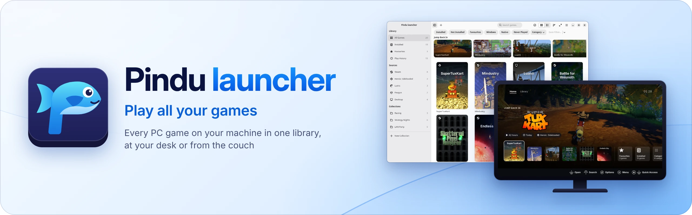

[Install](#installing) · [Features](#features) · [Fullscreen mode](#fullscreen-mode) ·
[Report a bug](https://github.com/Tim-van-Oudheusden/pindu-launcher/issues/new) ·
[Roadmap](https://github.com/Tim-van-Oudheusden/pindu-launcher/milestones)

[](https://github.com/Tim-van-Oudheusden/pindu-launcher/actions/workflows/ci.yml)
[](https://github.com/Tim-van-Oudheusden/pindu-launcher/tags)
[](#building-from-source)
[](#installing)
[](#tech-stack)
[](LICENSE)
[](https://github.com/Tim-van-Oudheusden/pindu-launcher/commits/main)

</div>

<p align="center">
  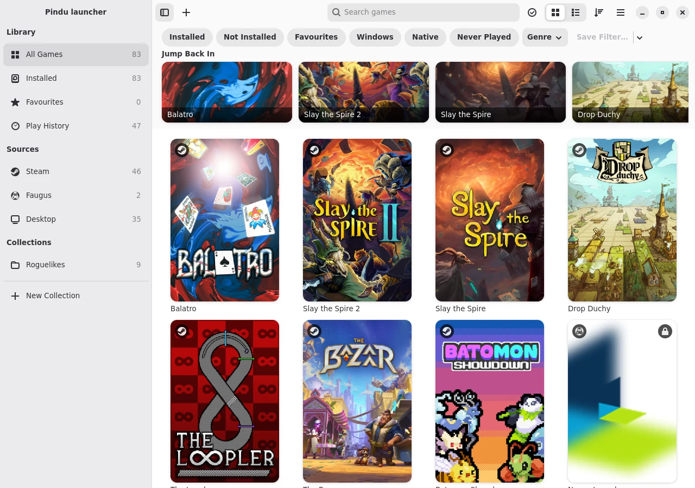
</p>

<p align="center">
  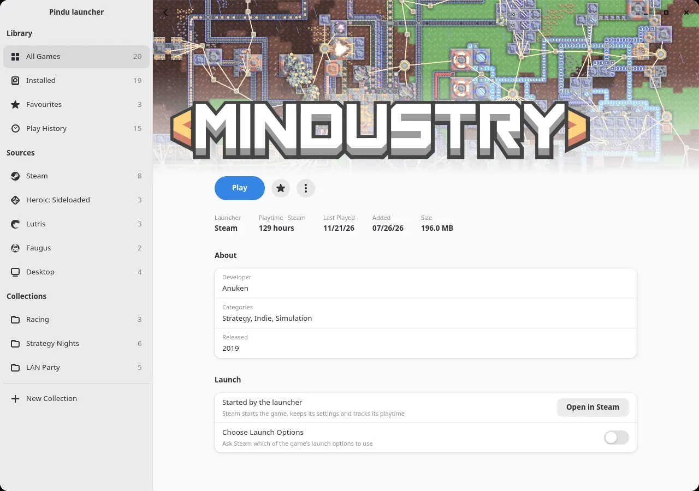
  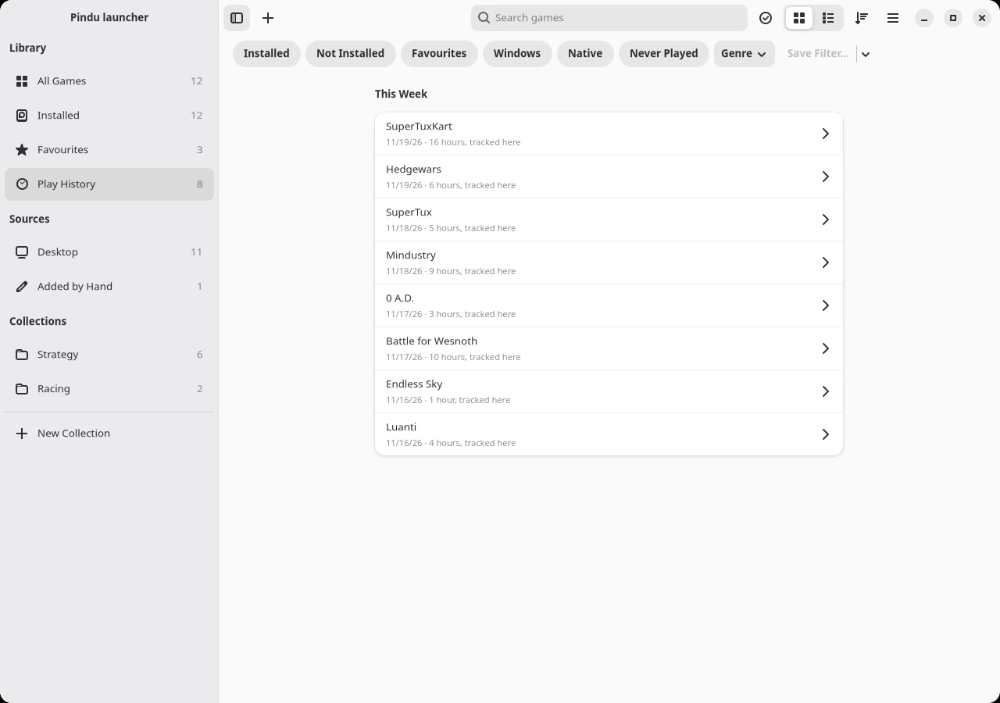
  <br>
  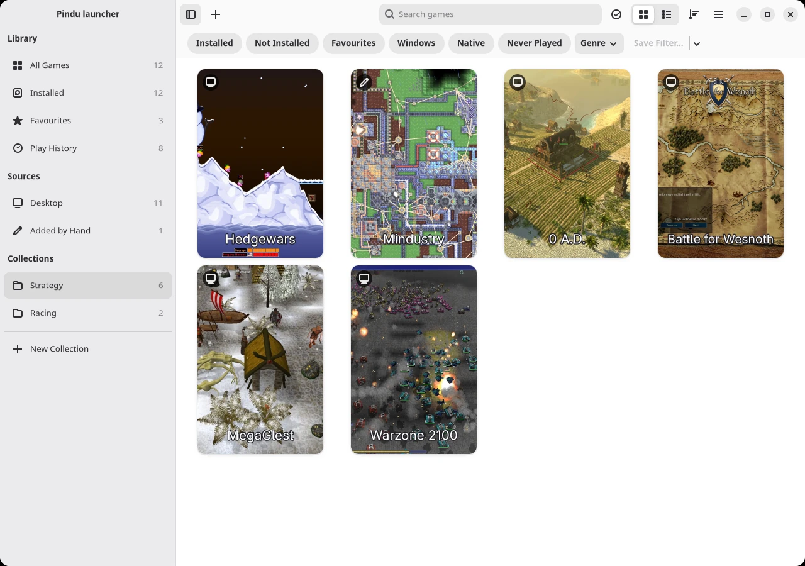
  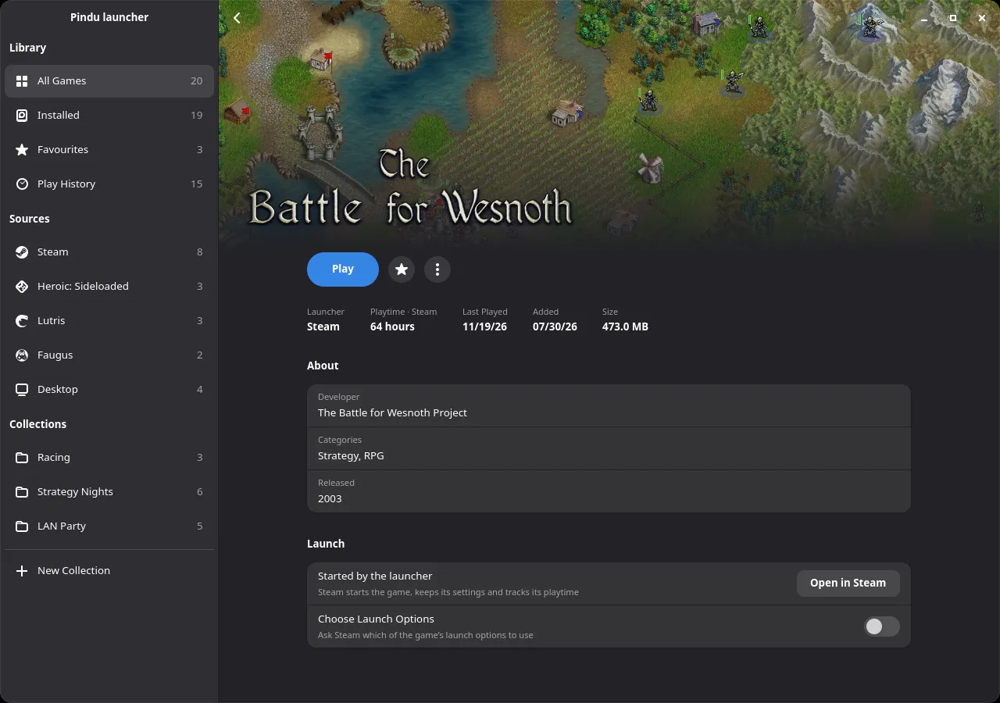
</p>

## Status

Pindu launcher is in early development and runs on Linux only. Each
[GitHub release](https://github.com/Tim-van-Oudheusden/pindu-launcher/releases) has a Flatpak bundle and native
packages for Fedora 45, Debian testing and Ubuntu 26.10 ([Installing](#installing)). A Flathub listing will come
later. The [milestones](https://github.com/Tim-van-Oudheusden/pindu-launcher/milestones) track progress.

## About

Pindu launcher puts every game on your computer in one library, whichever launcher installed it. On the desktop you
browse your covers, pick up where you left off and start a game with one click. Fullscreen mode does the same from the
couch with a controller. Both modes show the same library and use stock GTK 4 and libadwaita widgets, so the app looks
and behaves like the rest of GNOME.

## Features

- Games from Steam, Heroic, Lutris, Bottles, Faugus, Legendary and itch, games installed as apps (Flatpaks included)
  and games you add yourself sit side by side in one library ([Game sources](#game-sources)). The library syncs again
  when a launcher's files change.
- Store games start through their own launcher, which keeps their settings, updates and playtime. Pindu launcher reads
  the launchers' files and never writes to them.
- You can add a Windows game, or its installer, by hand. It runs with Proton through
  [umu](https://github.com/Open-Wine-Components/umu-launcher) in a prefix of its own. Preferences and fullscreen mode's
  Quick Access download GE-Proton and Proton-CachyOS builds, and MangoHud and GameMode can be turned on per game.
- **Start Safely**, in a game's page menu or in fullscreen mode's options, starts a game Pindu runs itself once without
  its wrappers, MangoHud, GameMode or its own environment variables. It keeps a log, as **Play with Logs** does, so you
  can tell a broken overlay or wrapper from a broken game. The game's saved settings do not change. When the last
  launch failed, the game's page says why and offers Start Safely with the other next steps the game has.
- Fullscreen mode is made for the couch and a controller. It has its own Home, library and game pages, a Quick Access
  panel, an on-screen keyboard for search, and navigation sounds. You can switch between its designs and add your own
  CSS ([Fullscreen mode](#fullscreen-mode)).
- The desktop window shows your covers in a grid, or in a list with each game's source, install state, last played
  date and playtime. Both layouts can be searched, sorted and filtered by installed, favourite, Windows or native,
  category or never played. You can group games into your own collections, or save a filter and search as a collection
  that keeps itself up to date: **Save Filter…** sits beside the filters, and its arrow suggests ones such as installed
  and never played. Recent games are a click away in Jump Back In, and games you never play can be hidden.
- The **Select** button in the header bar picks several games at once, in the grid or the list. You can then
  favourite them, hide them, add them to a collection or remove them from one in one go, with a toast to undo, or merge
  them into one game.
- When the same game comes from two launchers, **Merge With…** in its menu (or in its options sheet in fullscreen mode)
  makes it one game with several copies. Its **Preferred Copy** menu, or its page, chooses the copy Play starts, and
  **Split Into Separate Games** separates them again for good. A Lutris entry that links to a Steam, GOG or Epic game
  in the library is grouped with that game when the library syncs. Copies that only share a title are suggested under
  **Duplicates**, in the main menu and in fullscreen mode's Quick Access, where you group them or say they are not the
  same game. Groups made automatically can be undone ([Game identity](docs/game-identity.md)).
- Play history shows when you played and for how long, including the playtime your launchers recorded.
- A Steam game's page menu, and its options sheet in fullscreen mode, open the game's
  [ProtonDB](https://www.protondb.com) and [PCGamingWiki](https://www.pcgamingwiki.com) pages in your browser. Pindu
  launcher only passes the address on and fetches nothing from either site. In both modes the game's page also shows
  its Steam Deck rating (Verified, Playable, Unsupported or Unknown) as Steam's own files record it.
- Covers, banners and logos come from your launchers, from your own files, or from
  [SteamGridDB](https://www.steamgriddb.com) with your own API key, which is kept in the system keyring. **Change
  Artwork** on a game's page, in both modes, pages through every SteamGridDB image of each kind.
- **Edit…** in a game's page menu sets the game's developer, categories, release year and description. Your changes
  survive the next import, and clearing a field brings back the launcher's value.
- Metadata from [Wikidata](https://www.wikidata.org) is optional. Turn on **Get Metadata From Wikidata** in Preferences
  (or in Quick Access's Manage section), then choose **Refresh Metadata** in the main menu or under that switch. Pindu
  launcher looks your games up on Wikidata by their Steam app ID and keeps their developer, labelled in your language
  where Wikidata has it, and the categories their genres fit, such as Strategy for a 4X game. The lookup is off by
  default and runs only when you ask, never during an import; you can cancel it in Activity. Wikidata's details are
  shown over your launchers', which stay stored underneath. Wikidata's categories are added to your launcher's instead
  of replacing them, and details you enter yourself come before both. A game's page marks each detail from Wikidata
  with **Wikidata** and the date it was fetched, and on the desktop a button beside the detail opens the game's
  Wikidata page.
- Typing a game's name in the GNOME Shell Activities overview starts it.
- The library works without a network. Pindu launcher goes online only for the artwork, metadata and Proton builds you
  ask for.
- You can export your collections, saved filters, favourites, hidden games, games added by hand, tracked playtime,
  groups of copies and the game details you set to a file, and import them again. Before an update changes the
  library's format, Pindu launcher saves a copy of the library beside it, named for the format it had (such as
  `library.db.v5.bak`), and keeps the two newest copies.
- When a Windows game you added by hand quits normally, Pindu launcher copies its saves out of the game's prefix into
  `~/Games/pindu-launcher/save-snapshots`. It leaves out caches, runtimes, screenshots and stored logins, and keeps the
  last five snapshots. Any game can have save folders as well: add them with the file chooser under **Save
  Snapshots…** in the game page's menu. Its snapshots then hold those folders, taken when a game Pindu launcher starts
  quits normally or when you choose **Take Snapshot Now**. If the app cannot reach a folder, the list says why.
- **Save Snapshots…**, or Save Snapshots in fullscreen mode's options sheet, lists a game's snapshots with their time,
  size and every file they hold. Restoring one first keeps the current saves in a snapshot of their own. A restore
  never runs while the game does, and it writes only into the prefix's user folders and the game's save folders
  ([Save snapshots](docs/save-snapshots.md)). To keep a second copy, pick a folder under Preferences → Windows → Save
  Snapshots, such as one that Syncthing, Nextcloud or a drive keeps, and each new snapshot is copied there too. If that
  folder is gone, Pindu launcher reports it, and the game is not affected.

## Game sources

| Source | Games | How they start |
| --- | --- | --- |
| Steam, native or Flatpak | Installed games, with their playtime and Steam Deck rating | Through Steam |
| Heroic, native or Flatpak | Epic Games, GOG, Amazon and sideloaded games, installed or not | Through Heroic |
| Lutris, native or Flatpak | Lutris games | Through Lutris |
| Bottles, native or Flatpak | Programs in your bottles | Through Bottles |
| Faugus Launcher, native or Flatpak | Faugus games | On the host ([needs host access](#starting-games-on-the-host)) |
| Legendary, the standalone client, native only | Installed Epic Games Store games that Heroic does not already list | On the host with `legendary launch` ([needs host access](#starting-games-on-the-host)) |
| itch, native or Flatpak | Games installed through the itch app, with their playtime | Through the itch app |
| Desktop entries and Flatpaks | Games installed as apps | On the host ([needs host access](#starting-games-on-the-host)) |
| Added by hand | Native programs, and Windows games or installers | Native ones on the host; Windows ones with Proton in the sandbox |

The importers only read each launcher's data, and never its credentials. From the itch app's database, for example,
they read its installs and games, never the profiles that hold your itch.io key. Preferences → Sources shows, for each
source, the folder it was found in, when it last synced and the problems that sync ran into. Its **Copy Order** decides
which copy Play starts when a game has copies from several sources and you have not chosen one: the installed copy
from the source highest in the list, with native copies still ahead of Windows ones. **Move Up** and **Move Down**
change the order.

A game's page shows the details its launcher keeps offline. Heroic gives the developer, categories and description;
Steam's own app cache gives the developer, release year, categories and whether the game has full or partial
controller support; Lutris and Heroic's Amazon library give the release year. The launchers and Wikidata call
categories genres. All categories come from one set based on Steam's: Action, Strategy, RPG, Casual, Racing, Sports,
Indie, Adventure, Simulation and Massively Multiplayer, plus Shooter, Platformer, Puzzle and Fighting. Heroic's store
genres and Wikidata's are mapped onto that set, so they never add categories of their own. Categories you type in
**Edit…** can be anything.

The Flatpak has no permission for Legendary's `~/.config/legendary` or the itch app's folder (`~/.config/itch`, or
`~/.var/app/io.itch.itch/config/itch` for the itch Flatpak), and does not ask for one. Preferences → Sources says so,
and **Choose…** in the source's row imports a folder you pick in the file chooser. Native packages find these folders
themselves.

## Installing

### Flatpak bundle from a release

Each [release](https://github.com/Tim-van-Oudheusden/pindu-launcher/releases/latest) has a
`pindu-launcher-<version>-x86_64.flatpak` bundle, a `pindu-launcher-<version>-aarch64.flatpak` bundle for 64-bit ARM,
and a `SHA256SUMS` file. The bundle needs the GNOME 51 runtime, which Flatpak installs from Flathub, so add the Flathub
remote first:

```sh
flatpak remote-add --if-not-exists --user flathub https://dl.flathub.org/repo/flathub.flatpakrepo
flatpak install --user ./pindu-launcher-*-x86_64.flatpak
flatpak run io.github.tim_van_oudheusden.pindu-launcher
```

A bundle does not update itself. To update, install the next release's bundle the same way, from a folder that holds
only that bundle; each release's notes repeat this. To hear about new releases, use **Watch → Custom → Releases** at
the top of this repository's page.

### Native package

Fedora 45, Debian testing and Ubuntu 26.10 ship GTK 4.24 and libadwaita 1.10, and each release has a package for them:
`pindu-launcher-<version>-1.fc45.<arch>.rpm` (`x86_64` or `aarch64`), and
`pindu-launcher-<version>-debian-testing-<arch>.deb` and `pindu-launcher-<version>-ubuntu-26.10-<arch>.deb` (`amd64`
or `arm64`). Install the one for your system with `sudo dnf install ./<file>` or `sudo apt install ./<file>`.

Native packages run without the Flatpak sandbox and do not update themselves. Windows games need
[umu-launcher](https://github.com/Open-Wine-Components/umu-launcher#installing), which these distros do not package,
and the MangoHud switch needs your distro's `mangohud` package.

### Development bundle from CI

Every CI run uploads development bundles of the latest code as the `pindu-launcher-devel-x86_64.flatpak` and
`pindu-launcher-devel-aarch64.flatpak` artifacts. Open a recent run of the
[`CI` workflow](https://github.com/Tim-van-Oudheusden/pindu-launcher/actions/workflows/ci.yml) (you must be signed in
to GitHub), download the artifact for your machine and unzip it. Like a release bundle, it needs the GNOME 51 runtime
from Flathub:

```sh
flatpak remote-add --if-not-exists --user flathub https://dl.flathub.org/repo/flathub.flatpakrepo
flatpak install --user ./pindu-launcher-devel.flatpak
flatpak run io.github.tim_van_oudheusden.pindu-launcher-devel
```

The development build has its own app ID and nightly icon, and installs beside a stable one.

To build the app yourself, see [Building from source](#building-from-source).

### Starting games on the host

Store games start through the OpenURI portal and always work. Games that start as a program on the host (desktop
entries, Flatpak games, Faugus and Legendary games, and native games added by hand) need the app to reach the host
through `org.freedesktop.Flatpak`, which Pindu launcher never asks for itself. Until you grant that access, those games
say what is missing instead of failing, and **Preferences → Permissions** shows the command that grants it:

```sh
flatpak override --user --talk-name=org.freedesktop.Flatpak io.github.tim_van_oudheusden.pindu-launcher
```

> [!WARNING]
> Granting this access is a sandbox escape you choose to make. Access to `org.freedesktop.Flatpak` lets Pindu
> launcher run any command on your host as your user, outside the sandbox. Grant it only if you accept that.

Restart Pindu launcher afterwards. To take the access back:

```sh
flatpak override --user --no-talk-name=org.freedesktop.Flatpak io.github.tim_van_oudheusden.pindu-launcher
```

For the development build, use `io.github.tim_van_oudheusden.pindu-launcher-devel` in both commands.

## Fullscreen mode

Fullscreen mode shows the same library laid out for a controller, on the couch, on a TV or on a Steam Deck.

To open it, click **Fullscreen Mode** in the header bar, press <kbd>F11</kbd>, start the app with `--fullscreen`, or
turn on **Start in Fullscreen Mode** in Preferences. In a narrow window the button moves into the header bar's **View
Options** menu, next to the grid and list layouts and the sort order.

Quick Access → **Design** switches between four looks: the three designs that ship with the app, and Adwaita, the look
with no design ([Styling fullscreen mode](#styling-fullscreen-mode)).

<table>
  <tr>
    <th colspan="2">Lobby, the default design</th>
  </tr>
  <tr>
    <td align="center">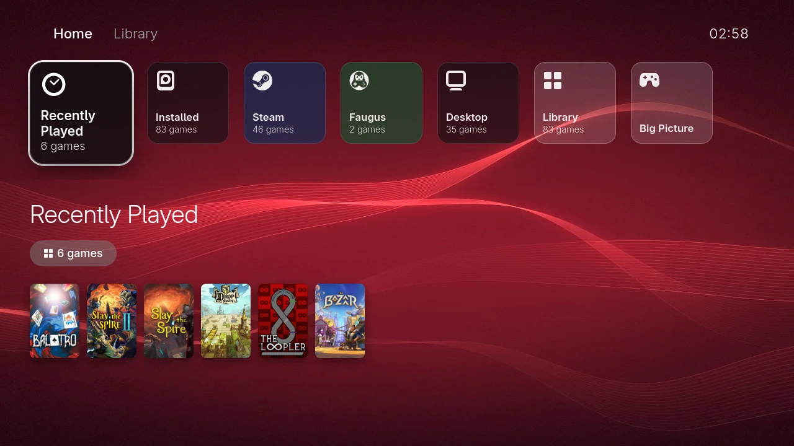<br><sub>Home</sub></td>
    <td align="center">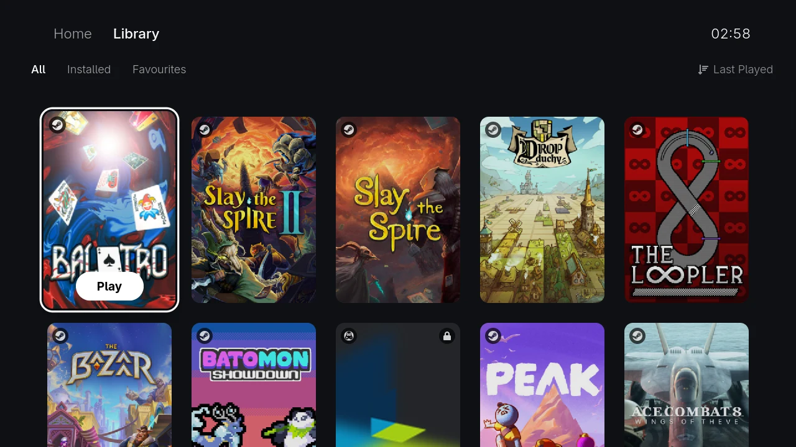<br><sub>Library</sub></td>
  </tr>
  <tr>
    <td align="center">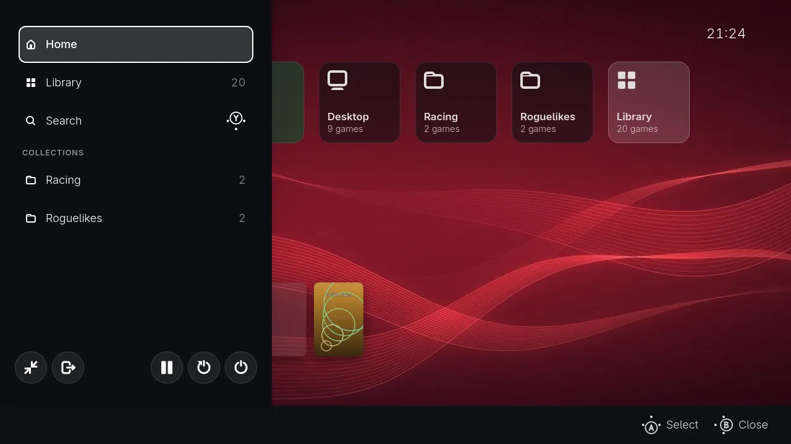<br><sub>Menu (Start)</sub></td>
    <td align="center">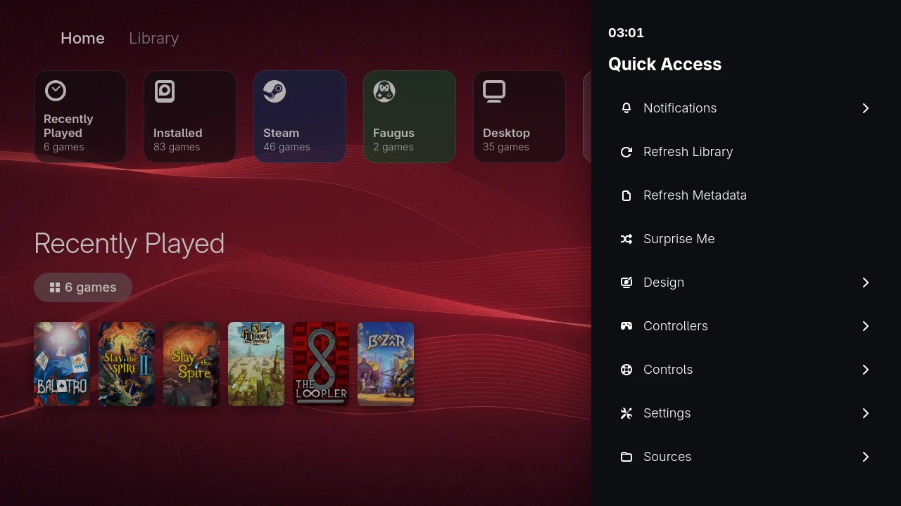<br><sub>Quick Access (R3, or Guide + A)</sub></td>
  </tr>
  <tr>
    <th colspan="2">Marquee</th>
  </tr>
  <tr>
    <td align="center">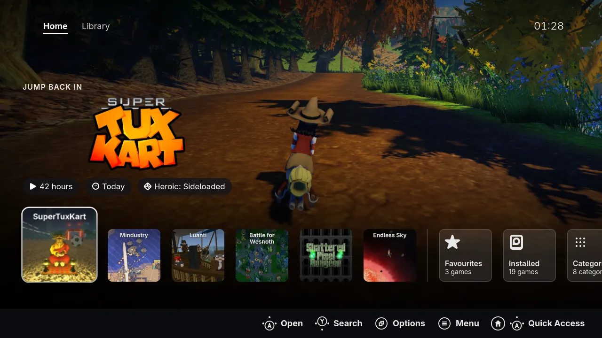<br><sub>Home</sub></td>
    <td align="center">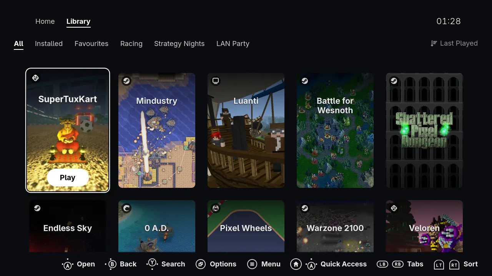<br><sub>Library</sub></td>
  </tr>
  <tr>
    <th colspan="2">Shelves</th>
  </tr>
  <tr>
    <td align="center">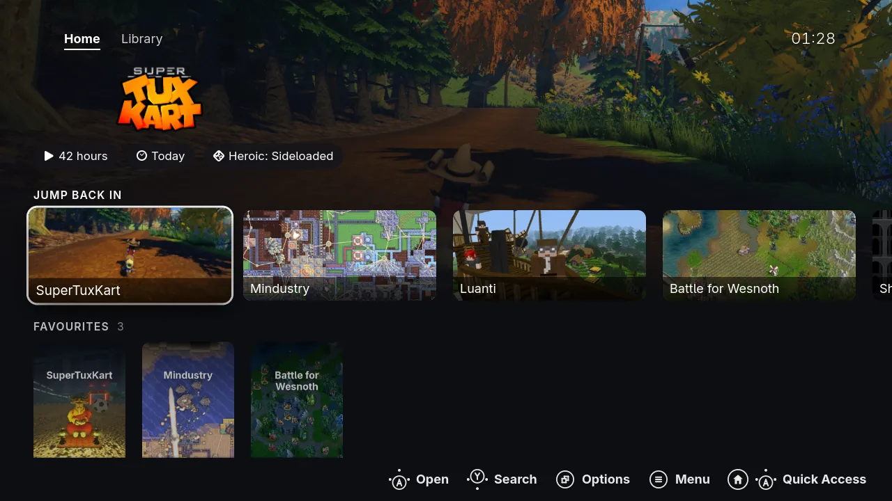<br><sub>Home</sub></td>
    <td align="center">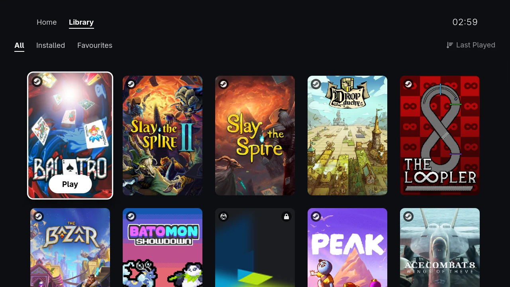<br><sub>Library</sub></td>
  </tr>
  <tr>
    <th colspan="2">Adwaita (no design)</th>
  </tr>
  <tr>
    <td align="center">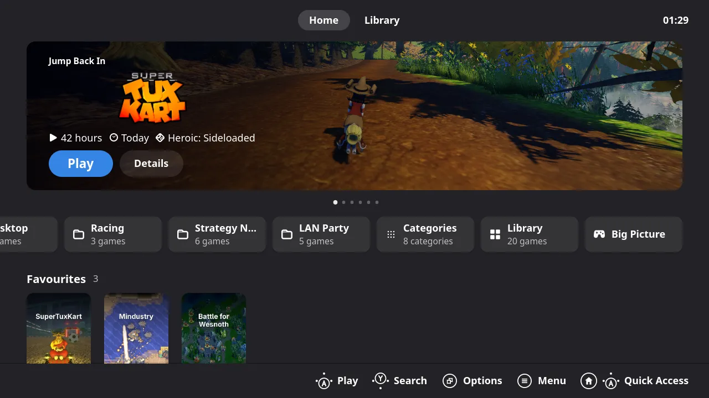<br><sub>Home</sub></td>
    <td align="center">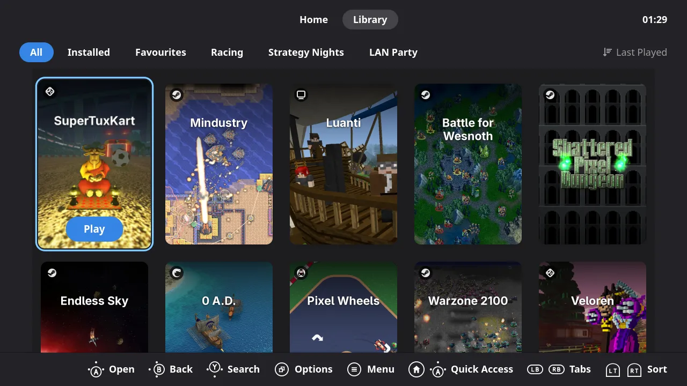<br><sub>Library</sub></td>
  </tr>
</table>

### Getting around

- Move with the D-pad or left stick, open with A and go back with B.
- Categories are on Home. Lobby and Marquee put them behind a **Categories** tile right after Installed, which opens a
  screen of categories, each leading to its games. Shelves and Adwaita show them as rows: one for each of the eight
  categories with the most games, and a **More Categories** row for the rest, each opening the library filtered to that
  category. **Categories on Home**, in Quick Access → Design or in Preferences, turns them off.
- A game page shows the game's developer, categories, release year, controller support, Steam Deck rating and
  description below its buttons. When a long description has focus, Down scrolls through it, and Up scrolls back to
  its start before focus moves on.
- The hint bar at the bottom names the buttons that work on each screen, drawn with the app's own glyphs for the
  controller you are holding.
- **What Each Button Does**, in Quick Access → Controller, lists everything the buttons do, grouped into moving, the
  library, the panels and launching. It shows the glyphs of the controller in use and the keys that do the same,
  including actions the hint bar leaves out, such as holding B to cancel a launch. Without a controller it lists only
  the keys.

### Collections

A game's options (View or X) add it to collections or take it out of them, and **New Collection…** creates one. The
menu drawer (Start or Guide) starts with its places: **Home**, **Library** with its number of games, and **Search**,
which starts a search with the on-screen keyboard as Y does. Under them it lists your first five collections, each with
its number of games, and **All Collections** lists every collection when you have more. A opens a collection's tab in
the library. View or X on a collection offers **Rename…**, **Move Up**, **Move Down** and **Delete…**, as the
collection menu in the desktop sidebar does.

- You type names with the on-screen keyboard, where capitals and symbols are a key away. Start or Done saves, and B on
  an empty name cancels.
- Delete asks first, with Cancel selected, so one stray press cannot delete a collection. The collection's games stay
  in the library.

### Power

The power dock is a row of round buttons at the bottom of the menu drawer (Start or Guide), always in view.
**Exit Fullscreen Mode**, **Exit Pindu Launcher** and similar buttons sit at its start, and **Suspend**, **Restart** and
**Power Off** at its end, so you can turn off a console that has no keyboard with a controller. Pressing Up at the top
of the menu wraps to the dock and lands on Suspend, so Suspend is Start, Up, A. Left and Right move along the dock, and
a line above it names the focused button.

- An action the system does not allow stays in the dock, dimmed. It takes focus, the line says why, and A does
  nothing. An action the machine cannot do at all is left out.
- While a game Pindu started is running, Restart and Power Off ask first, since the game's unsaved progress would be
  lost. Suspend does not ask, because the game carries on when the machine wakes.
- With **Hold to Confirm** on, in Quick Access → Controller or in Preferences, Restart and Power Off act only once the
  confirm button has been held down for a second.
- When a program is keeping the machine on (an update installing, for example), a notification names it.
- Over a running game, the menu has no dock.

The Flatpak has no access to the system bus, so it reaches the host's logind through
[host access](#starting-games-on-the-host). Without that access, Suspend, Restart and Power Off are dimmed and say that
Preferences can grant it. In a [gamescope-session-plus session](#a-gamescope-session-plus-session) the dock also has
**Switch to Desktop**, in the Flatpak as well. In the launcher's own session (`--session`, or a `--steam` gamescope
whose login session is named after gamescope or Pindu), the dock leaves out Exit Pindu Launcher, since quitting would
leave an empty screen.

### Quick Access

Open Quick Access with Guide + A (hold the Guide button and press the bottom face button, whatever its label), a right
stick click, the Steam Deck's "…" button, or <kbd>Ctrl</kbd>+<kbd>2</kbd>. Guide on its own acts when you release it,
so Guide + A never also opens the menu drawer.

Quick Access has six sections, shown as a strip of icons under its status header: **Quick**, **Notifications**,
**Design**, **Controller**, **System** and **Manage**. LB and RB, or <kbd>Ctrl</kbd>+<kbd>Page Up</kbd> and
<kbd>Ctrl</kbd>+<kbd>Page Down</kbd>, switch sections and wrap around; the pointer or a touch can press a section's
icon too. Quick Access opens on Quick, or on Notifications while a notification is unread. Each section remembers the
item you were on for as long as Quick Access stays open. [Fullscreen menus](docs/fullscreen-menus.md) lists what each
section holds; in short:

- The status header shows the time, the battery, whether you are offline, and the game you are playing with how long
  it has been running.
- **Quick** holds the Playing Now cards and a card for what the page underneath offers: **Filters** on the library,
  naming the filters that are on, and **Performance** for a game Pindu runs. Below them are tiles for Sound Output,
  Bluetooth, Network, Surprise Me, Refresh Library and Add a Game. While something runs in the background, a strip
  shows its progress and leads to Notifications.
- **Notifications** lists this session's events: games a sync added or found missing, artwork fetched or not, metadata
  refreshed or not, Proton downloads, games that need a permission, a Bluetooth device that failed to pair, connect,
  disconnect or be forgotten, a rollback or restart the system refused, a network that could not be joined, and a
  program that kept the machine from suspending, restarting or powering off.
- While something runs, **Running** at the top of Notifications shows its progress: a library sync, a SteamGridDB
  artwork fetch, a Wikidata metadata refresh, a Proton download, a store install from Add a Store, or a save snapshot
  or restore. Artwork fetches, metadata refreshes, Proton downloads and store installs can be cancelled. A cancelled
  download leaves nothing behind, and a cancelled refresh keeps what it had already stored.
- **Refresh Library** reads your launchers again, offline like every sync.
- **Surprise Me** opens the page of an installed game picked at random, never the same one twice in a row, so you
  still decide whether to play.
- **Design** switches the fullscreen design ([Styling fullscreen mode](#styling-fullscreen-mode)) and holds these
  settings:
  - **Cover Size** picks small, medium or large covers.
  - **Text Size** shows fullscreen text at its default size, or at Large, Larger or Largest, each step about a quarter
    of the default larger. Preferences has the same choice. An install that had the former Larger Text setting on
    starts at Large.
  - **Reduce Motion** holds Home's background still and changes art without a fade. Both also happen when the system's
    animations are off.
  - **Button Hints** shows the hint bar at the bottom of fullscreen mode and is on by default. Turning it off hides the
    bar, over a running game too, and changes nothing the buttons do. Preferences → Fullscreen has the same switch.
- **Controller** has **Hold to Confirm** (off by default) after Swap Confirm and Back. With it on, Power Off, Restart,
  Forget and Stop need the controller's confirm button held down for a second. A popover over the entry fills as you
  hold; letting go early or pressing another button does nothing, and the hint bar shows **Hold to Confirm** on those
  entries. The keyboard and the pointer still act at once.
- **System** ends with **Navigation Sounds**, which has a volume slider (Left and Right change it, here or in
  Preferences), and **Exit After Launching** in a list of their own, followed by **Diagnostics Report**.
- **Duplicates** lists copies that look like one game, with the reason and how certain the match is. A on one offers
  **Group** and **Not the Same Game**; a pair marked as not the same game is never suggested again. Groups the sync
  made from a Lutris store link appear there too, with **Undo Grouping**. The desktop window has the same list under
  **Duplicates** in the main menu.
- **Sources** lists every source Pindu imports from, says whether each was found on this computer, and has its
  **Import** switch, the same setting as in Preferences → Sources. A source turned off is no longer read, and changing
  a switch syncs the library, as it does in Preferences. A source's folder and its sidebar row are set only in
  Preferences. Below the sources, **Copy Order** lists them in the order a game's copies follow; Right on a source
  reaches its **Move Up** and **Move Down**.
- **Manage** has two groups after its entries:
  - **Artwork** holds your SteamGridDB key. You type it hidden with the on-screen keyboard (Show reveals it), and it is
    kept in the system keyring, never in settings or files. The row says whether a key is stored, or that the keyring
    cannot be used and why. Once a key is saved, missing art is fetched. **Prefer SteamGridDB Art** is here as well.
  - **Metadata** has **Get Metadata From Wikidata**, the same switch as in Preferences. While it is on, **Refresh
    Metadata** sits right under it and asks Wikidata for your games' developer and categories.
- **Sound Output**, subtitled with the output in use, lists the outputs PipeWire has (speakers, a television over HDMI,
  a receiver, a Bluetooth headset) and checks the one in use. Choosing one makes it the default. WirePlumber keeps the
  choice after a restart, and games that follow the default move to it. The entry reads the outputs with `pw-dump` and
  sets the default with `wpctl`, which the native packages pull in. The Flatpak has neither, so it does not show the
  entry.

### Filters

On the library page, **Filters** narrows every tab to installed or not installed games, to Windows or native games, or
to games never played, and can also show hidden games. **Category** narrows it to one of the library's categories, or
**Any Category**. A **Filtered** chip beside the tabs shows that a filter is on, and **Clear Filters** brings back the
whole tab. These filters are separate from the desktop window's filter row and last until the app quits.

**Save Filter…** saves the current tab, its filters and the search as a collection of its own, which gets a tab, a
Home section and a drawer entry. **Save Native Games**, **Save Windows Games** and **Save Installed and Never Played**
save those shelves in one press.

### Performance

For a game Pindu runs itself, **Performance** turns its **Performance Overlay** (MangoHud) and **GameMode** on or off
from the next launch. It is there while the game has focus or its page is open, and the game's options sheet (View or
X) has the same switches.

For a Windows game Pindu runs through Proton, Performance also chooses its **Proton** build from a list: the default
from Preferences, then the builds on this machine, newest first. This is the same setting as the Proton row on the
desktop game page, and it applies the next time the game starts.

- Store games have neither setting, since their launcher keeps their settings. Games that do not run through Proton
  have no Proton list.
- While the game is running, the panel says a change waits for its next start.
- In the Flatpak, Windows games and games in the Steam Linux Runtime get MangoHud from the
  `org.freedesktop.Platform.VulkanLayer.MangoHud` extension, which Flathub builds for x86_64 only. Games started on the
  host, and every game in a native package, use the system's `mangohud`. Without the extension, a Windows or Steam
  Runtime game's switch is greyed out and says MangoHud is not installed; the game keeps its setting.

### Network

Where NetworkManager runs, Quick Access → System has a **Network** entry, repeated in Quick. Its subtitle is the
connection in use: `Wired`, the Wi-Fi network's name, or `Offline`.

- Its level shows each wired and Wi-Fi device with its state (connected, connecting, disconnected, cable unplugged),
  the Wi-Fi switch, and the Wi-Fi networks in range, strongest first. Opening the level scans for networks. The network
  in use is checked, and saved networks say **Saved**.
- Selecting a new network joins it. An open network joins at once. A WPA/WPA2 or WPA3 personal network first asks for
  its passphrase, which you type with the on-screen keyboard (capitals and symbols are a key away, and Show reveals
  what you typed) or with a keyboard. The connection is saved, passphrase included, for every user of the machine, so
  it comes back after a restart before anyone logs in. A wrong passphrase is asked for again, and the connection it
  made is deleted.
- A saved network offers **Connect** and **Forget**. Forget asks first, then deletes the connection.
- Enterprise (802.1X) networks are listed but greyed out; set them up on another device. Hidden networks, static
  addresses, VPNs and proxies are not offered.
- If the system does not let the session change the network, the entry is greyed out and says so. Without a Wi-Fi
  device, the level shows only the wired state.

The Flatpak has no access to the system bus, so it does not show the entry.

### Bluetooth

Where [BlueZ](https://www.bluez.org/) runs and the machine has a Bluetooth adapter, Quick Access → System has a
**Bluetooth** entry, repeated in Quick. Its subtitle names the connected devices, or says that Bluetooth is off or
blocked. Its level lets you pair a wireless controller or headset using only a controller.

- A switch turns Bluetooth on or off. When airplane mode or a hardware switch blocks the radio, the level says so
  instead.
- **Paired Devices** come first. Each offers **Connect** or **Disconnect**, and **Forget**, which asks first because a
  forgotten device has to be paired again.
- **Found Devices** lists nearby devices while the level is open; the search stops when it closes. Selecting a device
  pairs it, trusts it so that it reconnects by itself after a restart, and connects it.
- When a device asks you to compare a code, the code is shown: A pairs and B refuses. A keyboard gets a code to type
  on it. When a device asks for a PIN or passkey, you type it with the on-screen keyboard, which opens on the digits,
  or with a keyboard.
- If something fails, a notification says why.

The Flatpak has no access to the system bus, so it does not show the entry; use the desktop's Bluetooth settings
instead.

### System Update

On [Pindu OS](https://github.com/Tim-van-Oudheusden/pindu-os), Quick Access → System has a **System Update** entry. Its
subtitle is the installed version, or "Update ready" once an update has downloaded. Pindu OS installs updates when the
console restarts, so the entry never restarts the console by itself.

- **Restart to Update** restarts into the waiting update.
- **Roll Back to *version*** asks first, then goes back to the previous version: the console restarts into it, and the
  version it was running stays installed so you can return to it. An update waiting at that moment is discarded.
- With a rollback queued, the entry says the previous version starts next time and offers **Restart**.
- If the system refuses to roll back or restart, a notification says why.

The entry does not show on other distributions or in the Flatpak.

### Library Health in Quick Access

Quick Access → Manage has a **Library Health** entry, subtitled with how many problems need attention. Its level shows
the same report as the desktop's Library Health page (**Sources**, **Launching**, **Artwork** and **Library Data**),
and you can read it with a controller alone. Each row takes focus. A problem's row names its next step and takes it on
A, closing Quick Access: it opens Preferences at Sources, Preferences at the host access command, or umu-launcher's
install instructions.

- Over a running game, the rows say the step is taken once the game has ended, since Preferences and web pages open
  over the launcher.
- A gamescope session has no browser, so there umu-launcher's row shows the address to open on another device.
- Rows that cannot apply to the session, such as host access outside the Flatpak, are left out rather than shown as
  errors.

### After the first sync

When the library's first sync finishes, **Your Library Is Ready** sums up what it found: the launchers, the games
imported and what needs attention. **Open Library Health** opens the Library Health page on the desktop, or Quick
Access at Library Health in fullscreen mode, where you can read and close the summary with a controller alone. The
summary shows only once; after you close it, it never comes back.

### Get Started

When fullscreen mode starts with no games and no store installed, as on a fresh Pindu OS install, Home shows a
**Get Started** checklist in place of its tiles, in the order a new console needs:

- **Connect a Controller**: opens Quick Access's Bluetooth to pair one, or its Controller section where the system has
  no Bluetooth to offer. Plug a first controller in with a cable, or use a keyboard, to get this far.
- **Join a Network**: opens Quick Access's Network, where the system offers it.
- **Choose a Design**: opens Quick Access's Design section; gone once a design was picked.
- **Add a Store**: opens Add a Store.
- **Sign In**: opens the installed store, Steam in Big Picture, to sign in. Opening Heroic or Lutris from here comes
  with #797.

Each step is marked done from what is true now: a controller connected, the machine online, a store installed. None is
forced, and they go in any order; closing Quick Access comes back to the list. **Hide This List** hides it, and Quick
Access → Manage → **Set-Up Checklist** brings it back. Once a game is in the library, it is gone for good. The desktop
window does not show it.

### Add a Store

A library with no games, such as a fresh Pindu OS install, offers **Add a Store** on its empty page, both in
fullscreen mode and on the desktop, and Quick Access → Manage has it at any time. It lists Steam, Heroic and Lutris
with a line on what each is for, marks the ones already installed, and installs the one you pick from Flathub, all
with a controller alone.

- The native packages run `flatpak` themselves. They install into the system installation when it has a `flathub`
  remote (Pindu OS ships one, and lets the console's user install without a password), and otherwise into your user
  installation, after adding Flathub to it. The install shows its progress here and in Activity, and can be cancelled.
- The Flatpak cannot install apps and gets no permission to, so it opens the store's page in your software centre and
  says so.
- Stores install from the internet. While the machine is offline, Add a Store says so and the stores wait; in fullscreen
  mode on Pindu OS its **Network** action opens Quick Access's Network level, and B from there leads back to Add a
  Store, where the stores are ready once the machine is online. An install that fails because Flathub cannot be
  reached says that, rather than `flatpak`'s own error, and offers Network next to Try Again.
- Once a store is installed, the library refreshes. Sign in to the store and its games appear: the library watches
  where each store it has not found yet keeps its library, so a store's first sign-in brings its games in without
  Refresh Library. In fullscreen mode, **Open Steam** comes first once Steam is installed, and so does the Steam
  Installed notification: they close Quick Access and open Steam in Big Picture, as Home's tile does, so its sign-in
  happens with a controller. Heroic and Lutris have no such action yet (#797).

### Proton

Quick Access → Manage → **Proton** does what the Windows and Proton pages in Preferences do for Proton, with a
controller alone.

- **Defaults** sets the Proton build Windows games run with unless their page names one (**Newest** follows the newest
  build on the machine), and whether games added from now on start with **MangoHud** and **GameMode**. These are the
  same settings as in Preferences. The default prefix folder and the folder save snapshots are copied to need a folder
  chooser, so they are set only in Preferences.
- **Downloaded Builds** lists the builds in the launcher's tools folder. Select one to remove it; the launcher asks
  first.
- **Check for Releases** lists the newest GE-Proton and Proton-CachyOS releases from GitHub. This is the only time the
  level goes online. Select a release to download and install it. Its row shows the progress, and the download is a
  task in Activity, where you can cancel it; selecting its row again also stops it. A notification says how it ended.

### Add a Game

**Add a Game** in Quick Access (in Quick and in Manage) adds a game by hand without leaving fullscreen mode, with a
controller alone. Choose a native game, an installed Windows game or a Windows installer, then:

- Pick the game's folder, or the installer, in a picker that fullscreen mode draws itself. It starts at the Games
  folder, your home folder and the drives the system has mounted under `/run/media/<user>`, and lists only folders
  and, for an installer, Windows programs. It shows only what the launcher can already read, and says so. The Flatpak
  gets no new permission, so there it reaches `~/Games` and the folders it already reads, but no drive. Mounting drives
  is the system's job.
- An installer runs through umu with the default Proton build in a new prefix. When it finishes, pick the program it
  installed.
- Pick the game's program from the ones found in its folder. The title is filled in from the program's name, and you
  can change it with the on-screen keyboard.

The last step picks a Windows game's Proton build from the same list as Performance: the default first, then the
builds on this machine, newest first. The game runs through umu, as on the desktop. Arguments, the working folder,
host spawn, a prefix of your choice and art are set in the desktop's Add Game and Edit dialogs.

### Controllers

- The **Controller** section of Quick Access lists the controllers it sees, with the glyphs each one shows and its
  battery level where the system reports one. Select a controller to make it rumble, so you can tell which is which.
- **Button Prompts** (there or in Preferences) picks the glyphs instead of following the controller: letters, shapes,
  or letters with A on the right. This helps under Steam Input, where every controller looks like Steam's own.
- **Swap Confirm and Back** makes the right button confirm and the bottom button go back everywhere in fullscreen
  mode.
- **Repeat Delay**, **Repeat Rate** and **Stick Dead Zone**, also in Quick Access → Controller, set how soon and how
  fast a held direction keeps moving focus, and how far the left stick must move before it does. A long delay suits a
  hand that lets go late, and a large dead zone suits a stick that drifts. These settings change only how the launcher
  moves its own focus; games receive the controller unchanged. When you hold a direction across many items, focus
  keeps that pace and stops where you let go. Home's art and the covers focus passes over wait until it stops, and the
  navigation sound plays every so often instead of on every step. A held arrow key behaves the same way.
- **Change Buttons** in Quick Access → Controller lists what the buttons can do (Select, Back, Search, Game Options,
  Menu, Quick Access and the tab and sort switches) with the button for each. Choose a function and press the button
  to give it; the function that had that button takes the old one. Guide, or five seconds without a press, leaves the
  function as it was. The choice is kept, and the hint bar, the menu's Search and What Each Button Does follow it at
  once. **Reset to Defaults** restores the usual buttons. Guide, the D-pad, the left stick and the keys never change.
  With Swap Confirm and Back on, a button is named by where it sits after the swap. Quick Access over a running game
  leaves out Change Buttons.

### Running in gamescope

For a couch setup, run fullscreen mode inside [gamescope](https://github.com/ValveSoftware/gamescope):

```sh
gamescope -f -- flatpak run --nosocket=wayland io.github.tim_van_oudheusden.pindu-launcher --fullscreen
```

- The app runs as an X11 client on gamescope's Xwayland, and its window fills gamescope's screen. A game window that
  opens takes gamescope's focus, and the app gets focus back when the game quits.
- `--nosocket=wayland` matters when gamescope starts from a desktop session. Without it, Flatpak gives the app the
  desktop's Wayland display, and the window opens on the desktop instead of in gamescope.
- Games the app starts on the host get the app's display rather than the desktop's: its `DISPLAY`, and with
  `--nosocket=wayland` an empty `WAYLAND_DISPLAY`. A game that would use Wayland therefore falls back to X11 in
  gamescope.
- `-f` makes gamescope's window fullscreen when it runs nested in a desktop session.
- Under X11 the app draws at scale 1. On a 4K screen, let gamescope upscale a smaller picture
  (`gamescope -W 3840 -H 2160 -w 1920 -h 1080 -f -- …`) or scale the app (`flatpak run --env=GDK_SCALE=2 …`).
- `--expose-wayland` is not recommended. With it the app runs as a Wayland client, but gamescope does not make its
  window fullscreen: the window keeps its desktop size, and gamescope scales it up to the screen.
- Once the app starts a game, the controller belongs to the game. The app responds only to Guide and to Quick Access
  through Guide + A or the Steam Deck's "…" (a right stick click stays with the game), and its hint bar shows only
  Guide, "Back to Pindu". The app takes the controller back on Guide, on Guide + A, when its window regains focus after
  losing it, on a key press in fullscreen mode, or when the last game it runs ends. A nested gamescope needs this most,
  because there the app's window keeps gamescope's focus while a game plays on the desktop.
- In a gamescope nested in a desktop session, a store game opens wherever its store's launcher runs. The desktop starts
  Steam, Heroic or Lutris through the OpenURI portal, so they and their games open on the desktop, not in gamescope,
  and a Steam client starting from a `steam://` link also shows its own window first. A gamescope session has no such
  desktop and keeps them in gamescope.

gamescope's `--steam` mode, which gamescope-session-plus and SteamOS-like sessions use, shows only windows that carry
an app ID, and only those named in the focus list on the root window. The app then takes Steam's place, so this works
too:

```sh
gamescope -f --steam -- flatpak run --nosocket=wayland io.github.tim_van_oudheusden.pindu-launcher --fullscreen
```

- The app detects `--steam` mode by itself (gamescope's `GAMESCOPE_FOCUSED_APP` on the root). Only then does it mark
  its window as app 769, Steam's ID, and write the focus list (`GAMESCOPECTRL_BASELAYER_APPID`). In a plain gamescope
  or on a desktop it writes nothing.
- A game the app starts gets an app ID of its own on its window (`STEAM_GAME`): its Steam app ID for a Steam game, and
  otherwise a stable ID with the high bit set. The app recognises the game's window by the window class it gives the
  game, by its process when the app is not sandboxed, or as the only new window while one game runs. The game comes to
  the front when it starts, and the app when it ends.
- Pressing and releasing Guide during play, without pressing another button, opens the menu drawer over the running
  game, just as Guide opens Steam's menu. The drawer is a see-through window of its own that gamescope draws above the
  game (`STEAM_OVERLAY`), and the game stays in front behind it. The drawer holds the game's Playing Now card (Return
  closes the drawer, and Stop ends a game the app started), Home, Library and the collections, which bring the app to
  the front; Search, leaving fullscreen mode and Power are left out. Guide again, or B, closes the drawer and gives
  input back to the game.
- When the game has more than one window gamescope could show (`GAMESCOPE_FOCUSABLE_WINDOWS`), such as its own
  launcher's and the game's, the drawer lists them by title under its card. Picking one pins it
  (`GAMESCOPECTRL_BASELAYER_WINDOW`) while the game is in front. When that window closes, gamescope shows the game's
  other window again.
- Guide + A, or the Steam Deck's "…", during play opens Quick Access over the running game in the same window. Either
  one again, or B, closes it, and Guide switches from it to the menu drawer. R3 stays with the game. The game also sees
  the A of Guide + A, because the app reads controllers alongside games and cannot take a press away from them.
- Over a game, Quick Access shows the levels that need no library page and no flow in the app's window. Performance
  applies to the game, Playing Now's Return and Stop work, and Surprise Me, Add a Store and Change Buttons are left
  out. Network's passphrase and Bluetooth's PIN, code and confirmation are asked for over the game and answered there
  with the controller. A passphrase still unanswered when Quick Access closes moves to the app's window and returns
  when Quick Access opens again. Closing Quick Access while pairing refuses the pairing, as leaving Bluetooth does. The
  controller still reaches the game while Quick Access is open.
- When `MANGOHUD_CONFIGFILE` names a file the app can write, as gamescope-session-plus and
  `gamescope --steam --mangoapp` set it, the Performance Overlay switch drives their MangoApp instead of wrapping games
  in `mangohud`. The app rewrites the file in place with `preset=2` or `no_display` for the game in front, both when
  the game comes to the front and when its switch flips in Quick Access or the options sheet. MangoApp hides itself
  while the app is in front. The Flatpak cannot reach `/tmp/mangohud.*` or `$XDG_RUNTIME_DIR/gamescope-mangoapp-*`, so
  point the variable at a file under `$XDG_RUNTIME_DIR/app/io.github.tim_van_oudheusden.pindu-launcher/` that holds
  `no_display` before gamescope starts. Otherwise games keep their own MangoHud.
- A game the app hands to its store's launcher (Steam, Heroic, Lutris, Bottles, Faugus, itch) is expected in front from
  the moment the store opens. Its windows, and any untagged window another app opens meanwhile, such as Steam's update
  or sign-in window, get the game's app ID and come to the front. When the last of those windows closes, the game
  counts as exited 2 seconds later unless another one opens. The app then returns to the front, and stops expecting
  the game 10 seconds after that window closed; a window of the game that opens before then brings the game back to
  the front. Until the game's first window opens, the app stays in front, and after a minute it stops waiting. Guide
  over the game opens the menu drawer, as with other games.
- From its first window until it exits, such a game counts as playing. Its page offers Return instead of Play, its
  options sheet offers Return and Stop, and it has a Playing Now card with Return and Stop. Return, or Play from
  anywhere else, brings it back to the front without handing it to the store again. The app cannot signal a process
  outside its sandbox, so Stop asks every window with the game's app ID, its store launcher's included, to close
  (`WM_DELETE_WINDOW`), and 5 seconds later ends the X11 clients of any windows still open (`XKillClient`). The Steam
  client itself keeps running.
- With [host access granted](#starting-games-on-the-host), Play hands a Steam game to Steam on the host as
  `steam -silent steam://rungameid/<id>` (`flatpak run com.valvesoftware.Steam -silent …` for a library from the Steam
  Flatpak) instead of through the OpenURI portal. A Steam client that is not running yet then starts without its
  library window, and one that is already running gets the link as before. Steam's prompts still show. Without host
  access, the link goes through the portal.
- A Steam client that a Steam game starts inside the session tags its own windows as app 769, as the app's window is
  tagged, and writes the focus list itself. In a `--steam` gamescope it runs as Big Picture, in one window. The app
  therefore pins its own window (`GAMESCOPECTRL_BASELAYER_WINDOW`) whenever it should be in front, including while a
  game it wants in front has no window yet. When another client changes the focus list or the pin, the app writes its
  own back, at most ten times in 10 seconds. Its games come to the front as usual.
- Where Steam is installed, or a Steam folder was found, Home has a **Big Picture** tile that hands
  `steam://open/bigpicture` to Steam the way Play hands it a Steam game: to the Steam Flatpak or the host's `steam`,
  whichever has the library, or else whichever the desktop shows, so the tile is there before Steam's first start. In
  this session Big Picture then takes the app's place: the Steam client's newest window is pinned, a game Steam starts
  comes to the front, and the app leaves the controller to Steam while Steam's window or that game is in front,
  including after Steam hides its window for the game. Once Big Picture's last window has closed and no game Steam
  started is running, the app is back in front with the controller at once. A Steam window that opens in the next 10
  seconds, such as Big Picture's after an update window on a cold start, takes its place again. Until Steam's first
  window shows, the app keeps the controller and the tile says Opening…. Choosing the tile again gives up, and so does
  a minute with no window, or 10 minutes on Steam's first start, which downloads the client's update first.
- While a Steam store launch waits for the game's window, the Steam client's windows are pinned in the app's place,
  newest first, so you can answer what Steam asks. Big Picture shows sign-in, install, launch option and cloud conflict
  prompts inside its window. The launch does not time out while one of these windows is open; once the last one
  closes, the app is back and waits another minute for the game. Guide over such a window brings the app back and
  stops waiting. Steam windows that open after the game has shown (such as a cloud sync when it ends) stay hidden, and
  a launch through another store never shows Steam.
- This was tested with gamescope 3.17.0 (`gamescope --backend headless --steam --xwayland-count 2`). gamescope's
  `--steam` protocol is undocumented and may change between releases.

#### A gamescope-session-plus session

On ChimeraOS, Bazzite and other distributions with
[gamescope-session-plus](https://github.com/ChimeraOS/gamescope-session), fullscreen mode can be a session of its own
at login, next to "Steam Big Picture". The native packages install it: pick **Pindu launcher** in the login screen's
session menu. A build from source installs it with `meson setup -Dgamescope-session=true _build`, which puts the client
file in `share/gamescope-session-plus/sessions.d/pindu` and the login entry in
`share/wayland-sessions/gamescope-session-pindu.desktop`. The entry only shows where `gamescope-session-plus` is
installed.

- The session runs `pindu-launcher --fullscreen --session`. `--session` tells the app that it is the session's client.
  The session ends when the app quits, so closing the app's window does nothing, and the power dock has no Exit Pindu
  Launcher. Switch to Desktop, Restart and Power Off leave the session.
- **Switch to Desktop** in the power dock runs `/usr/lib/os-session-select desktop`, the distribution's script for
  switching to the desktop session, and then quits. It asks first while a game Pindu started is running. Where the
  distribution has no `os-session-select`, the button is left out.
- The client file points `MANGOHUD_CONFIGFILE` at `$XDG_RUNTIME_DIR/pindu-launcher/mangohud.conf`, which holds
  `no_display`. It falls back to the desktop (`short_session_recover`) after five sessions in a row that each ended
  within a minute.

The Flatpak installs no session files. To use the Flatpak as the session's client, create
`~/.config/gamescope-session-plus/sessions.d/pindu` yourself:

```sh
CLIENTCMD="flatpak run --nosocket=wayland io.github.tim_van_oudheusden.pindu-launcher --fullscreen --session"
MANGOHUD_CONFIGFILE="$XDG_RUNTIME_DIR/app/io.github.tim_van_oudheusden.pindu-launcher/mangohud.conf"
mkdir -p "$XDG_RUNTIME_DIR/app/io.github.tim_van_oudheusden.pindu-launcher"
echo no_display >"$MANGOHUD_CONFIGFILE"
```

- `$XDG_RUNTIME_DIR/app/<app-id>/` is the only folder in the runtime directory that the sandbox shares with the host,
  so the app can reach the MangoApp settings there.
- The login entry is for the distribution to add, as a `/usr/share/wayland-sessions/gamescope-session-pindu.desktop`
  with `Exec=gamescope-session-plus pindu` and `DesktopNames=gamescope`. Without it, start the session with
  `gamescope-session-plus pindu`.
- The Flatpak sees the host's `os-session-select` at `/run/host/usr/lib/os-session-select`. Switch to Desktop runs it
  on the host, which needs the access described in [Starting games on the host](#starting-games-on-the-host). Without
  that access, the button is greyed out.

### Styling fullscreen mode

Three designs ship with the app. Lobby, the default, has labelled section tiles over the animated background, with a
preview of the focused section. Marquee opens Home on your recent games over the focused game's art, with the sections
at the end of the same row. Shelves puts every section on one screen, each as a row of its games.

Adwaita is the look with no design, and the one shown in high contrast. It follows GNOME Software's Explore page in
libadwaita's own colours: a header bar with the Home and Library tabs in the middle, a carousel of your recent games
with Play and Details on each page, a row of section tiles, then a row of covers for each section. Quick Access floats
as a rounded card of pill-shaped rows, like GNOME Shell's quick settings, and the menu drawer is a plain sidebar.

Ribbon and Panorama no longer ship. If you used either, fullscreen mode opens in Lobby.

Quick Access → Design switches designs. A design can come in variants, picked under the design. The same level sets
the blur and the dimming of Home's background (Off, Low or High for each), chooses the animated background for a
design that offers the choice (Lobby), and turns **My Stylesheet**, your own CSS, on and off.
[`docs/fullscreen-style.md`](docs/fullscreen-style.md) says where the files go and lists the `theme.json` fields and
the CSS names designs can rely on.

## Building from source

The build needs GTK 4.24, libadwaita 1.10, libmanette 0.2.10, blueprint-compiler, Meson and Rust 1.93 or newer. The
`org.gnome.Sdk//51` runtime with the `rust-stable` extension provides all of them, and Fedora 45, Debian testing and
Ubuntu 26.10 ship them too.

To run, the app also needs GStreamer's good plug-ins (`gstreamer1-plugins-good` on Fedora,
`gstreamer1.0-plugins-good` on Debian and Ubuntu). Fullscreen mode's Home background is VP9 video in Matroska and the
navigation sounds are WAV, and GTK plays both through its GStreamer backend. Without the plug-ins the background stays
black and the sounds are silent. The Flatpak runtime and the native packages include them.

Home's background is VP9, which GStreamer decodes in hardware where it has a decoder for the GPU (its VA plug-in, in
the bad plug-ins, with a VA-API driver such as Mesa's) and on the CPU otherwise. While it plays, the app watches the
window's frame rate: when it stays well under what the video needs for a few seconds, the background holds its first
frame for the rest of the session, so an older machine stays responsive. It also pauses while a panel is open over
Home.

```sh
git clone https://github.com/Tim-van-Oudheusden/pindu-launcher.git
cd pindu-launcher
meson setup _build
meson compile -C _build
meson test -C _build
```

Each release also has `pindu-launcher-X.Y.Z.tar.xz`, made by `meson dist`. It holds the sources with every crate
vendored, so the same Meson commands build it without a network, as distribution package builds require.

| Command | What it does |
| --- | --- |
| `cargo fmt --all --check` | Formatting check |
| `cargo clippy --workspace --all-targets -- -D warnings` | Lints (the Rust for Linux set in `Cargo.toml`), with warnings as errors |
| `RUSTDOCFLAGS="-D warnings" cargo doc --workspace --no-deps` | Rustdoc lints and documentation on every public item |
| `cargo test --workspace` | Unit tests; the core crate's tests need no display |
| `meson test -C _build` | Meson tests, including the translation file checks |
| `meson compile -C _build pindu-launcher-pot` | Refreshes the translation template |

### Development Flatpak

The development manifest builds the app with the `development` profile, which installs it as
`io.github.tim_van_oudheusden.pindu-launcher-devel` beside the stable app, with the nightly icon:

```sh
flatpak-builder --user --install --force-clean _flatpak \
  build-aux/flatpak/io.github.tim_van_oudheusden.pindu-launcher-devel.yml
flatpak run io.github.tim_van_oudheusden.pindu-launcher-devel
```

CI builds the same manifest, runs the tests in it (including a UI smoke test under xvfb), lints the manifest and the
build with `flatpak-builder-lint`, and uploads the bundle. Each lint exception in
`build-aux/flatpak/lint-exceptions.json` gives its reason.

The release manifest, `build-aux/flatpak/io.github.tim_van_oudheusden.pindu-launcher.yml`, builds the stable app that
GitHub releases ship. It has the same permissions and modules as the development manifest, which a Meson test checks,
and CI builds it on every pull request too. [`docs/releasing.md`](docs/releasing.md) explains how to cut a release.

## Translating

Translations are gettext `.po` files in `po/`, one for each language listed in `po/LINGUAS`, made from the template
`po/pindu-launcher.pot`. After changing translatable strings, refresh the template:

```sh
meson compile -C _build pindu-launcher-pot
```

Every file with translatable strings must be listed in `po/POTFILES.in`, which `meson test` checks. CI also runs
`po/check-pot.sh _build`, which fails when the template's strings differ from the code's, ignoring locations and dates.

Translations come in through [Weblate](https://hosted.weblate.org/projects/pindu-launcher/), which opens pull requests
and never pushes to `main`, so translate there. [`docs/translating.md`](docs/translating.md) has the Weblate component
settings (gettext PO, file mask `po/*.po`, template `po/pindu-launcher.pot`, the "Update LINGUAS file" and msgmerge
add-ons) and explains how to start a translation by hand.

## Tech stack

| Part | Built with |
| --- | --- |
| App | Rust (edition 2024), GTK 4.24 and libadwaita 1.10 through gtk4-rs, UI layout in Blueprint |
| Libraries | rusqlite for the library database, oo7 for the keyring, glycin for images, libsoup 3 for downloads, libmanette for controllers (through bindings in `crates/manette`) |
| Windows games | umu-launcher and Proton, with GameMode and MangoHud |
| Build and packaging | Meson driving cargo, Flatpak on `org.gnome.Platform//51` |
| CI | GitHub Actions. Every pull request runs rustfmt, clippy, the tests, the Flatpak build with a UI smoke test, and `flatpak-builder-lint`. After each merge and nightly, CI builds the release and aarch64 Flatpaks, the source tarball and the native packages, with their own smoke tests |

## Architecture

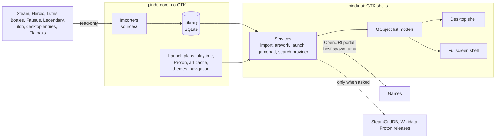

Everything that can be decided without GTK lives in `crates/pindu-core` and is tested with plain `cargo test`. The
shells never read files or spawn processes. They observe the models and send the user's intents back to the services,
so fullscreen mode is a second presentation of the same library.

## Documentation

| Document | Covers |
| --- | --- |
| [`docs/Adwaita Game Library — Main Spec.pdf`](docs/) | The product spec: scope, design and the issue plan |
| [`docs/Research — *.pdf`](docs/) | Research behind the spec: Cartridges, Heroic, Faugus, OpenGamepadUI, Flatpak and Flathub, the GNOME platform |
| [`docs/product-analysis.md`](docs/product-analysis.md) | The product and feature analysis behind milestones M6 to M9: workstreams, milestones and the decisions taken |
| [`docs/game-identity.md`](docs/game-identity.md) | Game identity: grouping one game's copies across sources, with a preferred copy |
| [`docs/library-health.md`](docs/library-health.md) | Library Health: one report on sources, launching, artwork and library data, and the first-run summary |
| [`docs/diagnostics.md`](docs/diagnostics.md) | Diagnostics: the debugging report in About, the bug form and fullscreen mode |
| [`docs/controller-parity.md`](docs/controller-parity.md) | Controller parity: what a console needs that only the desktop window can do today |
| [`docs/shelves-and-metadata.md`](docs/shelves-and-metadata.md) | Shelves and metadata: saved filters, offline metadata, values with their origin, an online provider |
| [`docs/launch-outcomes.md`](docs/launch-outcomes.md) | Launch outcomes and safe start: how each launch ended, failed-launch help, Start Safely |
| [`docs/save-snapshots.md`](docs/save-snapshots.md) | Save snapshots of Windows games in managed prefixes and of save folders added by hand, and restoring them |
| [`docs/accessibility-polish.md`](docs/accessibility-polish.md) | Accessibility polish: text sizes, held buttons, high contrast, screen reader, navigation settings |
| [`docs/emulation.md`](docs/emulation.md) | Emulation: what a first version would be and cost, and a recommendation; the decision is the maintainer's |
| [`docs/external-importers.md`](docs/external-importers.md) | External importers: a versioned JSON protocol for sources kept outside the core, and a recommendation; the decision is the maintainer's |
| [`docs/fullscreen-style.md`](docs/fullscreen-style.md) | The fullscreen style contract: design folders, `theme.json`, CSS names |
| [`docs/releasing.md`](docs/releasing.md) | How to cut a release: versions, notes, the tag and the Release workflow |
| [`docs/ai-ops-runbook.md`](docs/ai-ops-runbook.md) | Watching, pausing and reverting agent work; CI and Release failures; the `main` ruleset |
| [`docs/translating.md`](docs/translating.md) | How translations are laid out, the Weblate settings, and translating without Weblate |
| [`docs/agent-tasks/README.md`](docs/agent-tasks/README.md) | How each change traces to its issue: branch, commit, pull request and merge |
| [`docs/multi-agent.md`](docs/multi-agent.md) | Who works on the repository, how work moves between agents, and how changes merge |
| [`data/screenshots/CREDITS.md`](data/screenshots/CREDITS.md) | Where the store screenshots' game art comes from, and its licences |
| [`docs/screenshots/CREDITS.md`](docs/screenshots/CREDITS.md) | Where the README screenshots' game art comes from, and its licences |
| [`docs/brand/README.md`](docs/brand/README.md) | The README banner and the social preview image, and how to render them |
| [`docs/metrics/README.md`](docs/metrics/README.md) | The gates every change passes, what each measures and how to run it |
| [`docs/reflections/README.md`](docs/reflections/README.md) | Lessons from past sessions and incidents, and how to write one |
| [`CONTRIBUTING.md`](CONTRIBUTING.md) | How to build, find work and get a change merged |
| [`SECURITY.md`](SECURITY.md) | How to report a vulnerability, privately |
| [`docs/security/SECURITY-AI.md`](docs/security/SECURITY-AI.md) | Trust boundaries and safety rules for AI agents |
| [`CODE_OF_CONDUCT.md`](CODE_OF_CONDUCT.md) | How we treat each other, and how to report a problem |
| [`AGENTS.md`](AGENTS.md) | How AI agents work in this repository |
| [`AI_DISCLOSURE.md`](AI_DISCLOSURE.md) | Which parts of the project had AI assistance |

## Contributing

Work is tracked in [GitHub issues](https://github.com/Tim-van-Oudheusden/pindu-launcher/issues), grouped into
[milestones](https://github.com/Tim-van-Oudheusden/pindu-launcher/milestones). Bug reports are welcome; report security
problems privately, as [`SECURITY.md`](SECURITY.md) describes. Before writing code, read
[`CONTRIBUTING.md`](CONTRIBUTING.md), which covers building, picking an issue, working test-first and opening a pull
request that passes the quality gates. AI agents follow [`AGENTS.md`](AGENTS.md), and everyone follows the
[Code of Conduct](CODE_OF_CONDUCT.md).

### Reporting a bug

Open **About Pindu launcher** from the main menu, then **Troubleshooting → Debugging Information**, and copy or save the
report into the issue. The report names the version, how the app was installed, your distribution and session, each
source's state and game count, the sandbox permissions, the tools found, the library's schema version and the last
sync's problems. It holds no game titles and writes your home folder as `~`. Nothing is sent anywhere.

Fullscreen mode cannot copy text, so there you open Quick Access → System → **Diagnostics Report**. It shows the same
report in large text, one page at a time ("Page 1 of 3"), for a phone to photograph. LB and RB, or **Previous Page**
and **Next Page**, turn the pages, and Up and Down scroll a page that does not fit on the screen. Each time the report
opens, a copy is saved to `~/.local/share/pindu-launcher/reports/` (in the Flatpak,
`~/.var/app/io.github.tim_van_oudheusden.pindu-launcher/data/pindu-launcher/reports/`), named after the date and time.
The newest ten copies are kept, and the screen says where the copy went.

When a game misbehaves, add its newest log from **Play with Logs**. On the desktop, use **Debugging Information with
Log** in the game's **More Actions** menu; in fullscreen mode, use **Add a Game's Log** in the Diagnostics Report. The
report then includes that game's title, but still no other title and no home folder.

All other starts of a game Pindu runs itself keep a short log beside those: the last 64 KiB of the game's output, in
`~/.local/share/pindu-launcher/logs/<game>/` as `<date and time>.short.log`, with the newest five kept per game. Pindu
also records how each of a game's last five launches ended ([Launch outcomes](docs/launch-outcomes.md)). When the last
one failed, the game's page says why and lists the next steps that exist for the game: **How to Enable**, **How to
Install umu-launcher**, **Choose Another Proton Build**, **Start Safely** and **Open Log**, which opens that launch's
log. In fullscreen mode, the game's options list them.

## Acknowledgments

- [Cartridges](https://codeberg.org/kramo/cartridges) by kramo, the GNOME game launcher that showed how a libadwaita
  game library can look. Pindu launcher uses its Lutris, Bottles and Legendary icons.
- [Heroic Games Launcher](https://github.com/Heroic-Games-Launcher/HeroicGamesLauncher),
  [Lutris](https://github.com/lutris/lutris), [Bottles](https://github.com/bottlesdevs/Bottles),
  [Faugus Launcher](https://github.com/Faugus/faugus-launcher), [Legendary](https://github.com/legendary-gl/legendary)
  and [itch](https://github.com/itchio/itch), whose libraries Pindu launcher reads.
- [OpenGamepadUI](https://github.com/ShadowBlip/OpenGamepadUI), for how a couch-first game library behaves.
- [umu-launcher](https://github.com/Open-Wine-Components/umu-launcher),
  [GE-Proton](https://github.com/GloriousEggroll/proton-ge-custom) and
  [Proton-CachyOS](https://github.com/CachyOS/proton-cachyos), which run the Windows games.
- [SteamGridDB](https://www.steamgriddb.com), for community artwork.
- [Wikidata](https://www.wikidata.org), for game metadata (CC0).

## Disclaimer

Pindu launcher is not affiliated with Valve, Epic Games, GOG, Amazon or any launcher it imports from. Product names and
trademarks belong to their owners. Steam and the Steam logo are trademarks and/or registered trademarks of Valve
Corporation in the U.S. and/or other countries.

## Contact

- [GitHub](https://github.com/Tim-van-Oudheusden)
- [LinkedIn](https://www.linkedin.com/in/tim-van-oudheusden)
- [buildwithtim.dev](https://buildwithtim.dev)
- Other projects: [Dailies](https://github.com/Tim-van-Oudheusden/Dailies), daily guessing games in one GNOME app, and
  [MinimalUI](https://github.com/Tim-van-Oudheusden/MinimalUI), a minimal Android launcher for keyboard-centric phones

## Licence

| Path | Licence |
| --- | --- |
| Code and everything not listed below | [GNU General Public License v3.0 or later](LICENSE) |
| `data/io.github.tim_van_oudheusden.pindu-launcher.metainfo.xml.in` | [CC0 1.0](https://creativecommons.org/publicdomain/zero/1.0/) |
| `data/home/` (fullscreen Home's art) | [GPL-3.0-or-later](data/home/LICENSE) |
| `data/icons/sources/` (launcher icons) | Each icon's own terms, listed in [`LICENSE`](data/icons/sources/LICENSE): the Steam logo (Simple Icons, CC0 1.0, used under Valve's branding guidelines), Cartridges' Lutris, Bottles and Legendary icons (GPL-3.0-or-later), Faugus Launcher's logo (MIT) and the itch.io logo (itch.io press kit) |
| `docs/brand/` | [GPL-3.0-or-later](LICENSE); the text in the images is set in [Inter](https://github.com/rsms/inter), SIL Open Font License 1.1, and the game art in the screenshots they show keeps each game's own licence ([`CREDITS.md`](docs/screenshots/CREDITS.md)) |
| Game art in `data/screenshots/` | Each game's own licence, listed in [`CREDITS.md`](data/screenshots/CREDITS.md) |
| Game art in `docs/screenshots/` | Each game's own licence, listed in [`CREDITS.md`](docs/screenshots/CREDITS.md) |
