<div align="center">

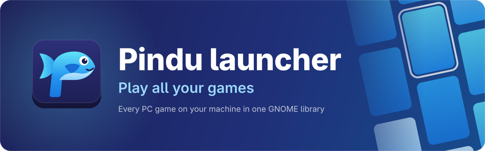

[Install](#installing) · [Features](#features) · [Fullscreen mode](#fullscreen-mode) ·
[Report a bug](https://github.com/Tim-van-Oudheusden/pindu-launcher/issues/new) ·
[Roadmap](https://github.com/Tim-van-Oudheusden/pindu-launcher/milestones)

[](https://github.com/Tim-van-Oudheusden/pindu-launcher/actions/workflows/ci.yml)
[](https://github.com/Tim-van-Oudheusden/pindu-launcher/tags)
[](#building-from-source)
[](#installing)
[](#tech-stack)
[](LICENSE)
[](https://github.com/Tim-van-Oudheusden/pindu-launcher/commits/main)

</div>

<p align="center">
  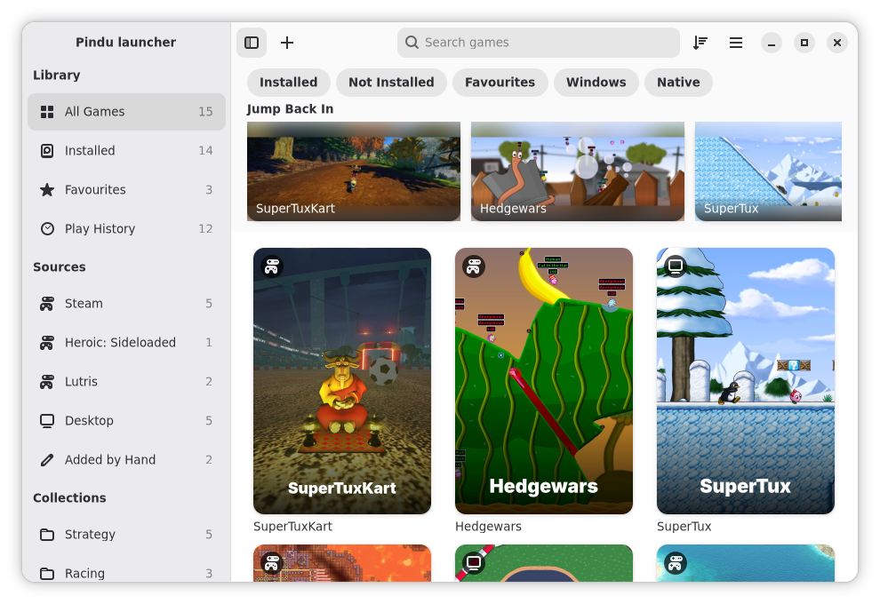
</p>

<p align="center">
  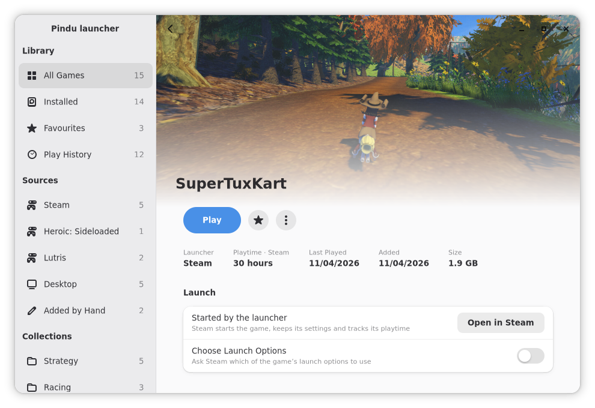
  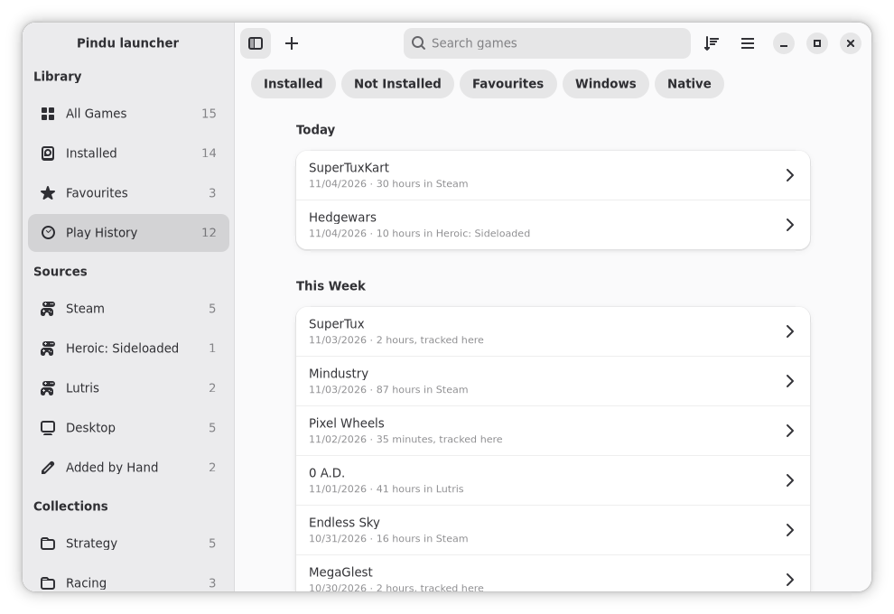
  <br>
  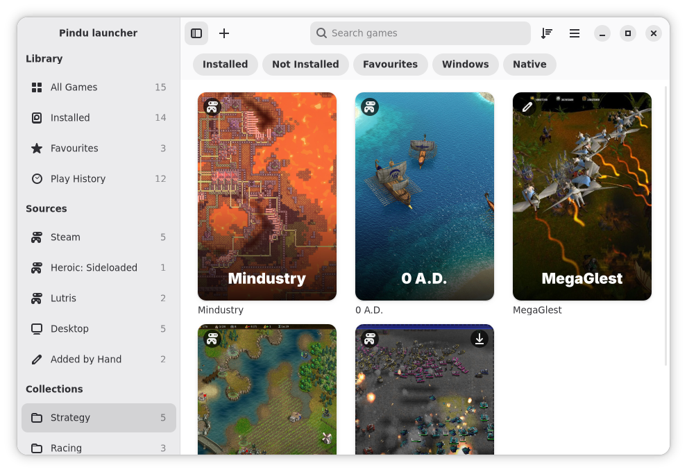
  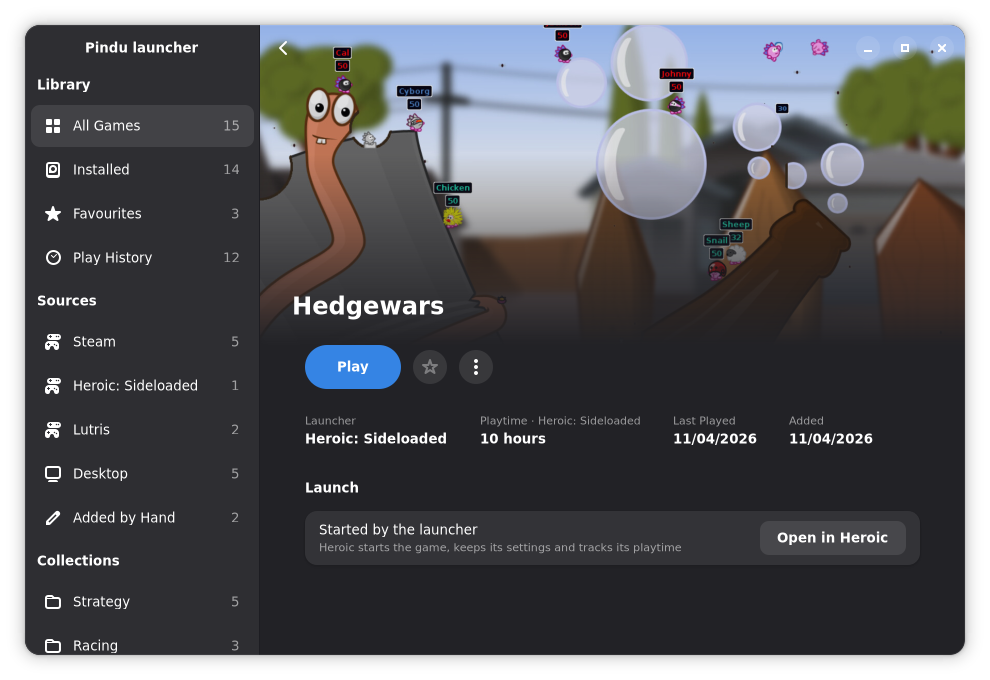
</p>

## Status

Early development. Releases ship on [GitHub Releases](https://github.com/Tim-van-Oudheusden/pindu-launcher/releases)
as a Flatpak bundle, with native packages for Fedora 45, Debian testing and Ubuntu 26.10 ([Installing](#installing));
a Flathub listing comes later. Linux only. Progress is tracked in the
[milestones](https://github.com/Tim-van-Oudheusden/pindu-launcher/milestones).

## About

Pindu launcher gathers every game on your computer into one library, whichever launcher installed it. Browse your
covers, pick up where you left off and start any game with one click, or switch to the fullscreen mode and do the same
from the couch with a controller. Both modes are views over the same library, built with stock GTK 4 and libadwaita
widgets so it looks and behaves like the rest of GNOME.

## Features

- **Every launcher, one library.** Steam, Heroic, Lutris, Bottles, Faugus, Legendary, itch, games installed as apps
  (Flatpaks included) and games you add yourself, side by side. The library resyncs when a launcher's files change.
- **Launchers stay in charge.** Store games start through their own launcher, which keeps their settings, updates and
  playtime. Pindu launcher only reads the launchers' files and never writes to them.
- **Windows games too.** Add a Windows game, or its installer, by hand and it runs with Proton through
  [umu](https://github.com/Open-Wine-Components/umu-launcher) in a prefix of its own. Download GE-Proton and
  Proton-CachyOS builds from Preferences or fullscreen mode's Quick Access, and turn on MangoHud or GameMode per game.
  Proton-CachyOS builds from Preferences, and turn on MangoHud or GameMode per game.
- **Start Safely.** When a game Pindu runs itself breaks, **Start Safely** in its page's menu, or in fullscreen's
  options, starts it once without its wrappers, MangoHud, GameMode or its own environment variables, and keeps a log
  as **Play with Logs** does, so a broken overlay or wrapper tells itself apart from a broken game. Its saved settings
  stay as they are.
- **A fullscreen mode for the couch.** A controller-first Home, library and game pages, a Quick Access panel, an
  on-screen keyboard for search and navigation sounds, with switchable designs and your own CSS
  ([Fullscreen mode](#fullscreen-mode)).
- **A tidy library.** Browse covers in a grid, or switch the desktop window to a list with each game's source, install
  state, last played date and playtime. Search, sort and filter by installed, favourite, Windows or native, in either
  layout. Group games into your own collections, jump back into recent games and hide the ones you never play. The
  **Select** button in the header bar picks several games in the grid or the list at once, to favourite, hide, add to
  a collection or take out of one in one go, with a toast to undo it.
- **Play history.** When you played and for how long, including the playtime your launchers recorded.
- **Help for Steam games.** A Steam game's page menu, and its options sheet in fullscreen mode, open the game's
  [ProtonDB](https://www.protondb.com) and [PCGamingWiki](https://www.pcgamingwiki.com) pages in your browser. Pindu
  launcher only hands the address over and fetches nothing from either site.
- **Your artwork.** Covers, banners and logos from your launchers, from your own files, or from
  [SteamGridDB](https://www.steamgriddb.com) with your own API key, which stays in the system keyring. **Change
  Artwork** on a game's page, in both modes, pages through every SteamGridDB image of each kind.
- **Search from GNOME Shell.** Type a game's name in the Activities overview to start it.
- **Offline and private.** The library works without a network. Pindu launcher goes online only for the artwork and
  Proton builds you ask for.
- **Backups.** Export your collections, favourites, hidden games, games added by hand and tracked playtime to a file,
  and import them again. Before an update changes the library's format, Pindu launcher keeps a copy of the library
  beside it, named for the format it had (such as `library.db.v5.bak`), and keeps the two newest copies.
- **Save snapshots.** When a Windows game you added by hand quits normally, Pindu launcher copies its saves out of the
  prefix it made for the game into `~/Games/pindu-launcher/save-snapshots`, leaving out caches, runtimes, screenshots
  and stored logins, and keeps the last five ([Save snapshots](docs/save-snapshots.md)).
- **Backups.** Export your collections, favourites, hidden games, games added by hand, tracked playtime and groups of
  copies to a file, and import them again. Before an update changes the library's format, Pindu launcher keeps a copy
  of the library beside it, named for the format it had (such as `library.db.v5.bak`), and keeps the two newest copies.

## Game sources

| Source | Games | How they start |
| --- | --- | --- |
| Steam, native or Flatpak | Installed games, with their playtime | Through Steam |
| Heroic, native or Flatpak | Epic Games, GOG, Amazon and sideloaded games, installed or not | Through Heroic |
| Lutris, native or Flatpak | Lutris games | Through Lutris |
| Bottles, native or Flatpak | Programs in your bottles | Through Bottles |
| Faugus Launcher, native or Flatpak | Faugus games | On the host ([needs host access](#starting-games-on-the-host)) |
| Legendary, the standalone client, native only | Installed Epic Games Store games that Heroic does not already list | On the host with `legendary launch` ([needs host access](#starting-games-on-the-host)) |
| itch, native or Flatpak | Games installed through the itch app, with their playtime | Through the itch app |
| Desktop entries and Flatpaks | Games installed as apps | On the host ([needs host access](#starting-games-on-the-host)) |
| Added by hand | Native programs, and Windows games or installers | Native ones on the host; Windows ones with Proton in the sandbox |

The importers read each launcher's data read-only and never its credentials: from the itch app's database they read
its installs and games, never the profiles that hold your itch.io key. Preferences, Sources shows for each source the
folder it was found in, when it last synced and the problems that sync ran into.

The Flatpak has no permission for Legendary's `~/.config/legendary` or the itch app's folder (`~/.config/itch`, or
`~/.var/app/io.itch.itch/config/itch` for the itch Flatpak), and does not ask for one: Preferences → Sources says so,
and **Choose…** in the source's row imports the folder you pick through the file chooser. Native packages find them
themselves.

## Installing

Pick one:

- **Download a release.** Each [release](https://github.com/Tim-van-Oudheusden/pindu-launcher/releases/latest) has a
  `pindu-launcher-<version>-x86_64.flatpak` bundle, a `pindu-launcher-<version>-aarch64.flatpak` bundle for 64-bit
  ARM, and a `SHA256SUMS` file. The bundle needs the GNOME 51 runtime, which Flatpak installs from Flathub, so add the
  Flathub remote first:

  ```sh
  flatpak remote-add --if-not-exists --user flathub https://dl.flathub.org/repo/flathub.flatpakrepo
  flatpak install --user ./pindu-launcher-*-x86_64.flatpak
  flatpak run io.github.tim_van_oudheusden.pindu-launcher
  ```

  A bundle does not update itself: install the next release's bundle the same way, from a folder that holds only that
  bundle.
- **Install a native package** on Fedora 45, Debian testing or Ubuntu 26.10, the distros with GTK 4.24 and
  libadwaita 1.10. Each release has `pindu-launcher-<version>-1.fc45.<arch>.rpm` (`x86_64` or `aarch64`),
  `pindu-launcher-<version>-debian-testing-<arch>.deb` and `pindu-launcher-<version>-ubuntu-26.10-<arch>.deb` (`amd64`
  or `arm64`); install the one for your system with `sudo dnf install ./<file>` or `sudo apt install ./<file>`. Native
  packages run without the Flatpak sandbox and do not update themselves, and Windows games need
  [umu-launcher](https://github.com/Open-Wine-Components/umu-launcher#installing), which these distros do not
  package. The MangoHud switch needs your distro's `mangohud` package.
- **Download a CI build.** Every CI run uploads a development bundle of the latest code as the
  `pindu-launcher-devel-x86_64.flatpak` and `pindu-launcher-devel-aarch64.flatpak` artifacts. Open a recent run of the
  [`CI` workflow](https://github.com/Tim-van-Oudheusden/pindu-launcher/actions/workflows/ci.yml) (you must be signed in
  to GitHub), download the artifact for your machine and unzip it. The bundle needs the GNOME 51 runtime, which
  Flatpak installs from Flathub, so add the Flathub remote first:

  ```sh
  flatpak remote-add --if-not-exists --user flathub https://dl.flathub.org/repo/flathub.flatpakrepo
  flatpak install --user ./pindu-launcher-devel.flatpak
  flatpak run io.github.tim_van_oudheusden.pindu-launcher-devel
  ```

  The development build has its own app ID and nightly icon, and installs beside a stable one.
- **Build from source.** See [Building from source](#building-from-source).

### Starting games on the host

Store games start through the OpenURI portal and always work. Games that start as a program on the host (desktop
entries, Flatpak games, Faugus and Legendary games, and native games added by hand) need the app to reach the host
through `org.freedesktop.Flatpak`, which Pindu launcher never asks for itself. Until you grant it, those games explain
what is missing instead of failing, and **Preferences → Permissions** shows the command:

```sh
flatpak override --user --talk-name=org.freedesktop.Flatpak io.github.tim_van_oudheusden.pindu-launcher
```

> [!WARNING]
> **This is a sandbox escape that you choose.** Access to `org.freedesktop.Flatpak` lets Pindu launcher run any
> command on your host as your user, outside the sandbox. Only grant it if you accept that.

Restart Pindu launcher afterwards. To take the access back:

```sh
flatpak override --user --no-talk-name=org.freedesktop.Flatpak io.github.tim_van_oudheusden.pindu-launcher
```

For the development build, use `io.github.tim_van_oudheusden.pindu-launcher-devel` in both commands.

## Fullscreen mode

A controller-first view of the same library, for the couch, a TV or a Steam Deck.

**To open it:** press <kbd>F11</kbd>, start the app with `--fullscreen`, or turn on **Start in Fullscreen Mode** in
Preferences.

<p align="center">
  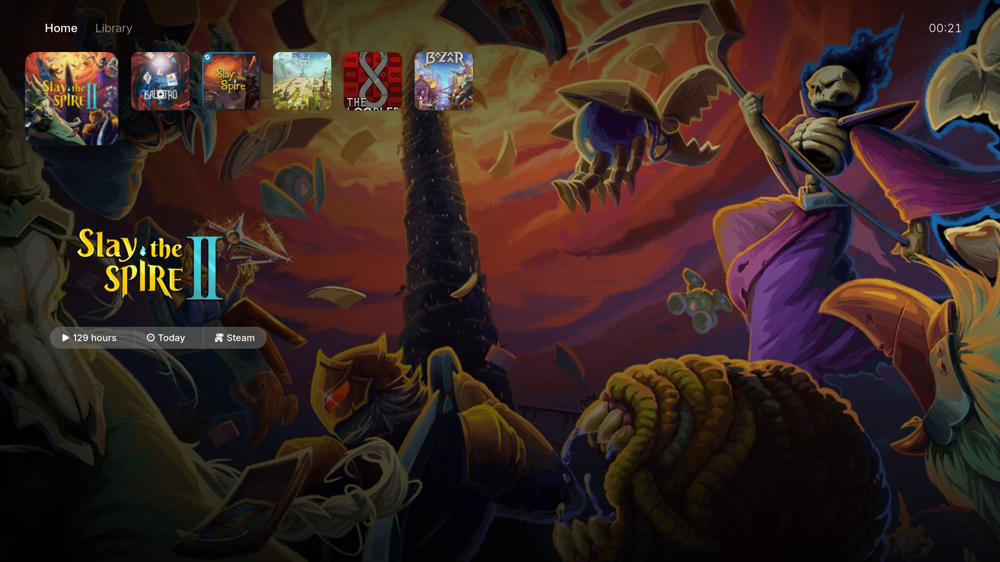
</p>

<p align="center">
  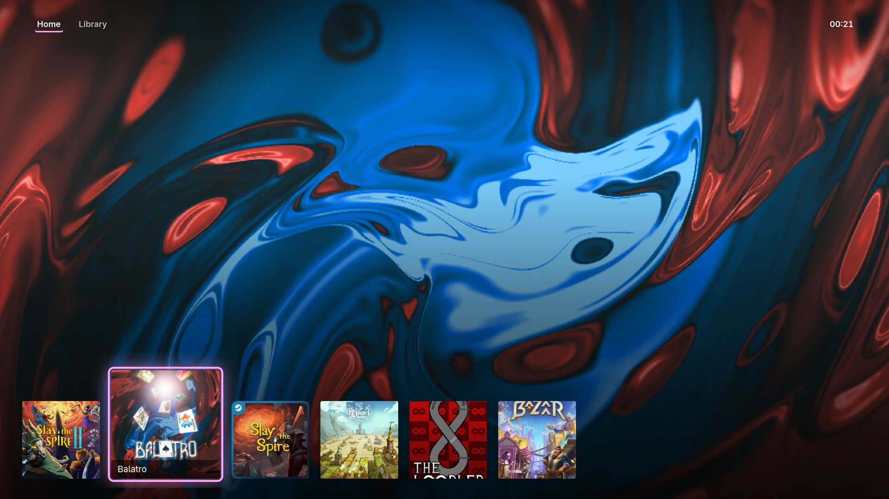
  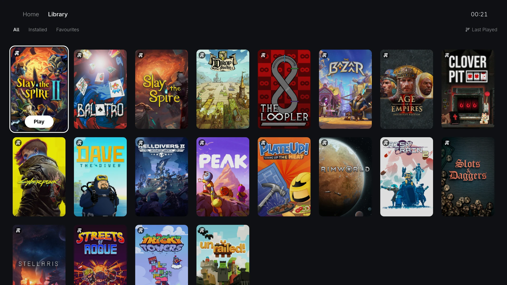
  <br>
  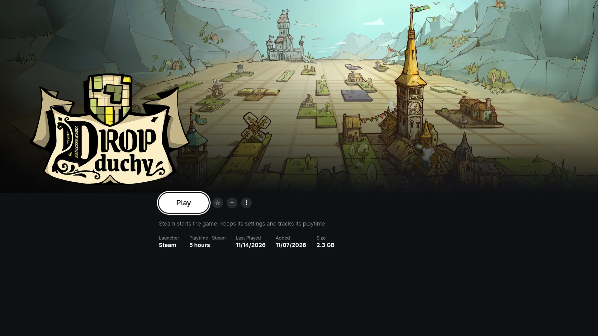
  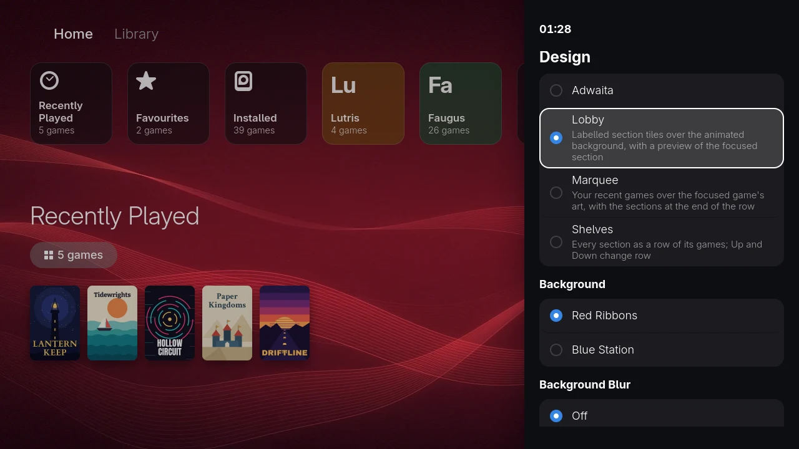
</p>

### Getting around

- **Move** with the D-pad or left stick, **open** with A and **go back** with B.
- A **game page** shows the game's developer, genres and description below its buttons. Once a long description has
  focus, Down scrolls through it and Up scrolls back to its start before moving on.
- The **hint bar** at the bottom names the buttons that work on each screen, drawn with the app's own glyphs for the
  controller you hold.
- **Controls** in Quick Access lists everything the buttons do, grouped into moving, the library, the panels and
  launching. It shows the glyphs of the controller in use and the keys that do the same, including ones the hint bar
  leaves out, such as holding B to cancel a launch. Without a controller it lists the keys alone.

### Collections

A game's options (View or X) add it to collections or take it out, and **New Collection…** makes one. **Collections**
in the menu drawer (Start or Guide) lists them; A opens one's tab in the library, and View or X on one leads to
**Rename…**, **Move Up**, **Move Down** and **Delete…**, as the desktop sidebar's collection menu has them.

- Names are typed with the on-screen keyboard (capitals and symbols are a key away); Start or Done saves, and B on an
  empty name cancels.
- Delete asks first, with Cancel chosen, so one stray press cannot delete a collection. Its games stay in the library.

### Power

The menu drawer (Start or Guide) ends with a **Power** entry, leading to **Suspend**, **Restart** and **Power Off**
where the system lets you, and then **Exit Pindu Launcher**, so a console without a keyboard can be turned off with a
controller. B steps back to the drawer's entries.

- An action the system does not allow is greyed out and says so; one the machine cannot do at all is not listed.
- While a game Pindu started is running, Restart and Power Off ask first, since its unsaved progress would be lost.
  Suspend does not ask: the game carries on when the machine wakes.
- With **Hold to Confirm** on in Quick Access's Accessibility or Preferences, Restart and Power Off act only once the
  confirm button has been held down for a second.
- When a program holds the machine on (an update installing, for example), a notification names it.

The Flatpak has no access to the system bus, so it asks the host's logind through
[host access](#starting-games-on-the-host); without it Suspend, Restart and Power Off are greyed out and say Preferences
gives the access. In a [gamescope-session-plus session](#a-gamescope-session-plus-session) the level also has **Switch
to Desktop**, in the Flatpak too. In the launcher's own session (`--session`, or a `--steam` gamescope whose login
session is named after gamescope or Pindu) it leaves out Exit Pindu Launcher, since quitting would leave an empty
screen.

### Quick Access

Open it with Guide + A (hold the Guide button and press the bottom face button, whatever its label), a right stick
click, the Steam Deck's "…" button, or <kbd>Ctrl</kbd>+<kbd>2</kbd>. Guide on its own acts when you let go of it, so
Guide + A never also opens the menu drawer.

- **Status:** the time, the battery, whether you are offline, and the game you are playing with how long it has run.
- **Notifications** from this session: games a sync added or found missing, artwork fetched or not, Proton downloads,
  games that need a permission, a Bluetooth device that did not pair, connect, disconnect or go, a rollback or restart
  the system refused, a network that could not be joined, and a program that kept the machine from suspending,
  restarting or powering off. Quick Access opens on them while one is unread.
- **Activity:** a running library sync, SteamGridDB artwork fetch, Proton download or save snapshot, with its progress.
  Artwork fetches and Proton downloads can be cancelled; a cancelled download leaves nothing behind.
- **Refresh Library** reads your launchers again, offline like every sync.
- **Surprise Me** opens the page of an installed game picked at random, never the same one twice in a row, so you
  still choose whether to play.
- **Design** switches the fullscreen design (see [Styling fullscreen mode](#styling-fullscreen-mode)).
- **Quick settings:** cover size, navigation sounds with a volume slider (left and right turn it, here or in
  Preferences), and exiting after a launch.
- **Accessibility:**
  - **Reduce Motion:** Home's background holds still and art changes without a fade, as it also does when the
    system's animations are off.
  - **Larger Text:** fullscreen text about a quarter larger.
- **Sources** lists every source Pindu imports from, says whether each was found on this computer, and has its
  **Import** switch, the same setting as Preferences, Sources: a source turned off is no longer read, and changing a
  switch syncs the library as it does there. A source's folder and its sidebar row stay in Preferences.
  - **Text Size:** fullscreen text at its default size or Large, Larger or Largest, each step about a quarter of
    the default larger. Preferences has the same choice; an install that had the former Larger Text on starts at
    Large.
  - **Hold to Confirm** (off by default): Power Off, Restart, Forget and Stop then need the controller's confirm button
    held down for a second. A popover over the entry fills as you hold, and letting go early or pressing another
    button does nothing; the hint bar says **Hold to Confirm** on them. The keyboard and the pointer still act at once.
- **Artwork:** your SteamGridDB key, typed hidden with the on-screen keyboard (Show reveals it) and kept in the system
  keyring, never in settings or files; the row says whether a key is stored, or that the keyring cannot be used and
  why. Missing art is fetched once a key is saved. **Prefer SteamGridDB Art** is here too.
- **Sound Output**, subtitled with the output in use, lists the outputs PipeWire has (speakers, a television over
  HDMI, a receiver, a Bluetooth headset) with a check on the one in use. Choose one to make it the default; WirePlumber
  keeps the choice after a restart, and games that follow the default move to it. It reads the outputs with `pw-dump`
  and sets the default with `wpctl`, which the native packages pull in. The Flatpak has neither, so there the entry
  is not shown.

### Filters

On the library page, **Filters** narrows every tab to installed or not installed games, or to Windows or native ones,
and can show hidden games too. A **Filtered** chip beside the tabs says a filter is on, and **Clear Filters** brings the
whole tab back. These filters are separate from the desktop window's filter row and last until the app quits.

### Performance

With a game Pindu runs itself focused, or on its page, **Performance** turns its **Performance Overlay** (MangoHud)
and **GameMode** on or off from its next launch. Its options sheet (View or X) has the same switches.

For a Windows game Pindu runs through Proton, Performance also lists its **Proton** build: the default from
Preferences, then the builds on this machine, newest first. It is the same setting as the desktop game page's Proton
row, and it applies the next time the game starts.

- Store games have neither, since their launcher keeps their settings; games that do not run through Proton have no
  Proton list.
- While the game runs, the panel says a change waits for its next start.
- In the Flatpak, Windows games and games in the Steam Linux Runtime get MangoHud from the
  `org.freedesktop.Platform.VulkanLayer.MangoHud` extension, which Flathub builds for x86_64 only. Games started on the
  host, and every game in a native package, use the system's `mangohud`. Without the extension, the switch of a
  Windows or Steam Runtime game is greyed out and says MangoHud is not installed; the game keeps its setting.

### Network

Where NetworkManager runs, Quick Access has a **Network** entry, subtitled with the connection in use: `Wired`, the
Wi-Fi network's name, or `Offline`.

- Its level shows each wired and Wi-Fi device with its state (connected, connecting, disconnected, cable unplugged),
  Wi-Fi's switch, and the Wi-Fi networks in range, strongest first. Opening it looks for networks. The network in use
  is checked, and saved ones say **Saved**.
- Selecting a new network joins it. An open one joins at once; a WPA/WPA2 or WPA3 personal one asks for its passphrase
  first, typed with the on-screen keyboard (capitals and symbols are a key away, and Show shows what you typed) or
  with a keyboard. The connection is saved for every user of the machine with the passphrase in it, so it comes back
  after a restart before anyone logs in. A wrong passphrase is asked for again, and the connection it made is deleted.
- A saved network opens to **Connect** and **Forget**, which deletes its connection after asking.
- Enterprise (802.1X) networks are listed but greyed out, to be set up on another device. Hidden networks, static
  addresses, VPNs and proxies are not offered.
- If the system does not let the session change the network, the entry is greyed out and says so. Without a Wi-Fi
  device the level has the wired state only.

The Flatpak has no access to the system bus, so the entry does not show there.

### Bluetooth

Where [BlueZ](https://www.bluez.org/) runs and the machine has a Bluetooth adapter, Quick Access has a **Bluetooth**
entry, subtitled with the connected devices, or with whether Bluetooth is off or blocked. Its level pairs a wireless
controller or headset with a controller only.

- A switch turns Bluetooth on or off. When airplane mode or a hardware switch blocks the radio, the level says so
  instead.
- **Paired Devices** come first. Each opens to **Connect** or **Disconnect**, and **Forget**, which asks first: a
  forgotten device has to be paired again.
- **Found Devices** lists what is nearby while the level is open; the search stops when it closes. Selecting one
  pairs it, trusts it so that it reconnects by itself after a restart, and connects it.
- When a device asks to compare a code, the code shows: A pairs, B refuses. A keyboard gets a code to type on it. When
  a device asks for a PIN or a passkey, you type it with the on-screen keyboard, which starts on the digits, or with a
  keyboard.
- If something does not work, a notification says why.

The Flatpak has no access to the system bus, so the entry does not show there; use the desktop's Bluetooth settings.

### System Update

On [Pindu OS](https://github.com/Tim-van-Oudheusden/pindu-os), Quick Access has a **System Update** entry, subtitled
with the installed version, or with "Update ready" once an update has downloaded. Pindu OS installs updates when the
console restarts, so the entry never restarts it by itself.

- **Restart to Update** restarts into the update that is waiting.
- **Roll Back to *version*** goes back to the previous version after asking: the console restarts into it, and the
  version it ran stays installed to go back to. An update waiting at that moment is discarded.
- With a rollback queued, the entry says the previous version starts next time and offers **Restart**.
- If the system refuses to roll back or restart, a notification says why.

Elsewhere, another distribution or the Flatpak, the entry does not show.

### Add a Store

A library with no games, such as a fresh Pindu OS, offers **Add a Store** on its empty page, in fullscreen mode and on
the desktop; Quick Access has it any time. It lists Steam, Heroic and Lutris with a line on what each is for, marks the
ones already installed, and installs the one you pick from Flathub, all with a controller alone:

- The native packages run `flatpak` themselves: into the system installation when it has a `flathub` remote (Pindu
  OS ships one, and lets the console's user install without a password), otherwise into your user installation, after
  adding Flathub to it. The install shows how far it is, here and in Activity, and can be cancelled.
- The Flatpak cannot install apps and gets no permission to, so it opens the store's page in your software centre
  and says so.
- Once a store is installed the library refreshes; sign in to the store, and its games show.

### Proton

Quick Access's **Proton** does what Preferences' Windows and Proton pages do for Proton, with a controller alone:

- **Defaults:** the Proton build Windows games run with unless their page names one (**Newest** follows the newest
  build on the machine), and whether games added from now on start with **MangoHud** and **GameMode**. These are the
  same settings as in Preferences. The default prefix folder needs a folder chooser, so it stays in Preferences.
- **Downloaded Builds** lists the builds in the launcher's tools folder; select one to remove it, after a question.
- **Check for Releases** lists the newest GE-Proton and Proton-CachyOS releases from GitHub, the only time the level
  goes online. Select one to download and install it: its row shows how far it is, and it is a task in Activity, where
  it can be cancelled; selecting its row again stops it too. A notification says how it ended.

### Controllers

- **Controllers** in Quick Access lists the controllers it sees, with the glyphs each shows and its battery where the
  system reports one. Select one to make it rumble, so you can tell which is which.
- **Button Prompts** (there or in Preferences) picks the glyphs instead of following the controller: letters, shapes,
  or letters with A on the right. This helps under Steam Input, where every controller looks like Steam's own.
- **Swap Confirm and Back** makes the right button confirm and the bottom one go back everywhere in fullscreen mode.
- **Repeat Delay**, **Repeat Rate** and **Stick Dead Zone**, also in Quick Access's Controllers, set how soon and how
  fast a held direction keeps moving focus, and how far the left stick moves before it does: a long delay for a hand
  that lets go late, a large dead zone for a stick that drifts. They change only how the launcher moves its own focus;
  a game receives the controller unchanged.
- **Controls** in the menu drawer (Start or Guide) lists what the buttons can do (Select, Back, Search, Game Options,
  Menu, Quick Access and the tab and sort switches) with the button for each. Choose one and press the button to give
  it; the function that had that button takes the old one. Guide, or five seconds without a press, leaves it as it was.
  The choice is kept, and the hint bar and Quick Access's Controls follow it at once. **Reset to Defaults** restores
  the usual buttons. Guide, the D-pad, the left stick and the keys never change, and with Swap Confirm and Back on, a
  button goes by where it sits after the swap. The drawer over a running game leaves Controls out.

### Running in gamescope

For a couch setup, run the fullscreen mode inside [gamescope](https://github.com/ValveSoftware/gamescope):

```sh
gamescope -f -- flatpak run --nosocket=wayland io.github.tim_van_oudheusden.pindu-launcher --fullscreen
```

- The app runs as an X11 client on gamescope's Xwayland, and its window fills gamescope's screen. A game window that
  opens takes gamescope's focus, and the app gets it back when the game quits.
- `--nosocket=wayland` matters when gamescope starts from a desktop session: without it, Flatpak gives the app the
  desktop's Wayland display, and the window opens on the desktop instead of in gamescope.
- Games the app starts on the host get the app's display rather than the desktop's: its `DISPLAY`, and with
  `--nosocket=wayland` an empty `WAYLAND_DISPLAY`, so a game that would use Wayland falls back to X11 in gamescope.
- `-f` makes gamescope's window fullscreen when it runs nested in a desktop session.
- Under X11 the app draws at scale 1. On a 4K screen, let gamescope upscale a smaller picture
  (`gamescope -W 3840 -H 2160 -w 1920 -h 1080 -f -- …`) or scale the app (`flatpak run --env=GDK_SCALE=2 …`).
- `--expose-wayland` is not recommended. The app then runs as a Wayland client, but gamescope doesn't make its window
  fullscreen: the window keeps its desktop size, and gamescope scales it up to the screen.
- Once the app starts a game, the controller is the game's: the app acts on no button but Guide and the Quick Access of
  Guide + A or the Steam Deck's "…" (a right stick click stays the game's), and its hint bar shows only Guide, "Back to
  Pindu". Guide, Guide + A, the app's window gaining focus again after it lost it, a key in fullscreen mode, or the last
  game the app runs ending gives the controller back. A nested gamescope needs this most: there the app's window keeps
  gamescope's focus while a game plays on the desktop.
- In a gamescope nested in a desktop session, a store game opens wherever its store's launcher runs. The desktop starts
  Steam, Heroic or Lutris through the OpenURI portal, so they and their games open on the desktop, not in gamescope; a
  Steam client starting from a `steam://` link also shows its own window first. A gamescope session has no such desktop
  and keeps them in gamescope.

gamescope's `--steam` mode, which gamescope-session-plus and SteamOS-like sessions use, shows only windows that carry
an app ID, and only the ones its focus list on the root names. The app then takes Steam's place, so this works too:

```sh
gamescope -f --steam -- flatpak run --nosocket=wayland io.github.tim_van_oudheusden.pindu-launcher --fullscreen
```

- The app notices `--steam` mode by itself (gamescope's `GAMESCOPE_FOCUSED_APP` on the root) and only then marks its
  window as app 769, Steam's ID, and writes the focus list (`GAMESCOPECTRL_BASELAYER_APPID`). In a plain gamescope or
  on a desktop it writes nothing.
- A game the app starts gets an app ID of its own on its window (`STEAM_GAME`): its Steam app ID for a Steam game,
  otherwise a stable ID with the high bit set. Its window is recognised by the window class the app gives it, by its
  process when the app is not sandboxed, or as the only new window while one game runs. The game comes to the front when
  it starts, and the app when it ends.
- Guide during play, let go without pressing another button, opens the menu drawer over the running game, in a
  see-through window of its own that gamescope draws above the game (`STEAM_OVERLAY`), as Guide opens Steam's menu.
  The game stays in front behind it. The drawer holds the game's Playing Now card (Return closes the drawer, Stop ends a
  game the app started), Home, Library and Collections, which bring the app to the front there; Controls, leaving
  fullscreen mode and Power are left out. Guide again, or B, closes it and gives input back to the game. When the game
  has more than one window gamescope could show (`GAMESCOPE_FOCUSABLE_WINDOWS`), such as its own launcher's and the
  game's, the drawer lists them by title under its card; picking one pins it (`GAMESCOPECTRL_BASELAYER_WINDOW`) while
  the game is in front, until it closes, when gamescope shows the game's other window again.
- Guide + A, or the Steam Deck's "…", during play opens Quick Access over the running game in the same window; either
  again, or B, closes it, and Guide turns from it to the menu drawer. R3 stays the game's. The game sees the A of
  Guide + A too: the app reads controllers alongside games and cannot take a press from them. Over a game Quick Access
  shows the levels that need no library page or flow of the app's window: Performance is the game's, Playing Now's
  Return and Stop work, and Surprise Me and Add a Store are left out. Network's passphrase and Bluetooth's PIN, code
  and confirmation are asked over the game and answered with the controller there. A passphrase still unanswered as
  Quick Access closes moves to the app's window and comes back when Quick Access opens again; closing it while pairing
  refuses, as leaving Bluetooth does. The controller still reaches the game while it is open.
- With `MANGOHUD_CONFIGFILE` naming a file the app can write, as gamescope-session-plus and `gamescope --steam
  --mangoapp` set it, the Performance Overlay switch drives their MangoApp instead of wrapping games in `mangohud`: the
  app rewrites the file in place with `preset=2` or `no_display` for the game in front, when it comes to the front and
  when its switch flips in Quick Access or the options sheet. MangoApp hides itself while the app is in front. The
  Flatpak cannot reach `/tmp/mangohud.*` or `$XDG_RUNTIME_DIR/gamescope-mangoapp-*`; point the variable at a file under
  `$XDG_RUNTIME_DIR/app/io.github.tim_van_oudheusden.pindu-launcher/` that holds `no_display` before gamescope starts.
  Otherwise games keep their own MangoHud.
- A game the app hands to its store's launcher (Steam, Heroic, Lutris, Bottles, Faugus, itch) is expected in front from
  the moment the store opens: its windows, and any untagged window another app opens meanwhile, such as Steam's update
  or sign-in window, get the game's app ID and come to the front. When the last of those windows closes, the game has
  exited 2 seconds later unless another opens: the app is back in front, and stops expecting the game 10 seconds after
  that window closed. A window of the game that opens before then brings the game back to the front. While none has
  opened the app stays in front, and after a minute it stops waiting. Guide over it opens the menu drawer as with other
  games. From its first window until it has exited, the game counts as playing: its page offers Return instead of Play,
  its options sheet Return and Stop, and it has a Playing Now card with Return and Stop. Return, or Play from anywhere
  else, brings it back to the front without handing it to the store again. Stop, which the app cannot do by signalling
  a process outside its sandbox, asks every window with the game's app ID, its store launcher's too, to close
  (`WM_DELETE_WINDOW`), and ends the X11 clients of the ones still there 5 seconds later (`XKillClient`); the Steam
  client itself keeps running.
- With [host access granted](#starting-games-on-the-host), Play hands a Steam game to Steam as
  `steam -silent steam://rungameid/<id>` on the host (`flatpak run com.valvesoftware.Steam -silent …` for a library
  from the Steam Flatpak) instead of through the OpenURI portal, so a Steam client that is not running yet starts
  without its library window; one that runs already gets the link as before. Its prompts still show. Without host
  access the link goes through the portal.
- A Steam client that a Steam game starts inside the session tags its own windows (in a `--steam` gamescope it runs as
  Big Picture, one window) as app 769, as the app's window is, and writes the focus list itself. The app therefore pins
  its window (`GAMESCOPECTRL_BASELAYER_WINDOW`) whenever it should be in front, including while a game it wants in
  front has no window yet, and writes its focus list and pin back when another client changes them, at most ten times
  in 10 seconds. Its games come to the front as usual.
- Where a Steam folder was found, Home has a **Big Picture** tile that hands `steam://open/bigpicture` to Steam the way
  Play hands it a Steam game. In this session Big Picture then takes the app's place: the Steam client's newest window
  is pinned, a game Steam starts comes to the front, and the app leaves the controller to Steam while Steam's window or
  that game is in front, also after Steam hides its window for the game. Once Big Picture's last window has closed and
  no game Steam started is running, the app is back in front with the controller at once; a Steam window that opens in
  the next 10 seconds, such as Big Picture's after an update window on a cold start, takes its place again. Until
  Steam's first window shows, the app keeps the controller and the tile says Opening…; choosing the tile again gives
  up, as does a minute with no window.
- While a Steam store launch waits for the game's window, the Steam client's window (Big Picture, which shows a
  sign-in, install, launch option or cloud conflict prompt inside it) is pinned in the app's place, the newest first,
  so the user can answer what Steam asks. The launch does not time out while one is open; once the last one closes the
  app is back and waits another minute for the game. Guide over such a window brings the app back and stops waiting.
  Steam windows that open once the game has shown (such as a cloud sync when it ends) stay hidden, and a launch through
  another store never shows Steam.
- Tested with gamescope 3.17.0 (`gamescope --backend headless --steam --xwayland-count 2`). gamescope's `--steam`
  protocol is undocumented and may change between releases.

#### A gamescope-session-plus session

On ChimeraOS, Bazzite and other distributions with
[gamescope-session-plus](https://github.com/ChimeraOS/gamescope-session), the fullscreen mode can be a session of its
own at login, next to "Steam Big Picture". The native packages install it: pick **Pindu launcher** in the login
screen's session menu. A build from source installs it with `meson setup -Dgamescope-session=true _build`, which puts
the client file in `share/gamescope-session-plus/sessions.d/pindu` and the login entry in
`share/wayland-sessions/gamescope-session-pindu.desktop`. The entry only shows where `gamescope-session-plus` is
installed.

- The session runs `pindu-launcher --fullscreen --session`. `--session` tells the app that it is the session's
  client: the session ends when the app quits, so closing its window does nothing, and the drawer's Power level has no
  Exit Pindu Launcher. Switch to Desktop, Restart or Power Off leave the session.
- **Switch to Desktop** in the drawer's Power level runs `/usr/lib/os-session-select desktop`, the distribution's
  script that switches to the desktop session, and then quits. It asks first while a game Pindu started is running.
  Where the distribution has no `os-session-select`, the entry is not there.
- The client file points `MANGOHUD_CONFIGFILE` at `$XDG_RUNTIME_DIR/pindu-launcher/mangohud.conf`, holding
  `no_display`, and falls back to the desktop (`short_session_recover`) after five sessions in a row that ended within
  a minute.

The Flatpak installs no session files. To use the Flatpak as the session's client, create
`~/.config/gamescope-session-plus/sessions.d/pindu` yourself:

```sh
CLIENTCMD="flatpak run --nosocket=wayland io.github.tim_van_oudheusden.pindu-launcher --fullscreen --session"
MANGOHUD_CONFIGFILE="$XDG_RUNTIME_DIR/app/io.github.tim_van_oudheusden.pindu-launcher/mangohud.conf"
mkdir -p "$XDG_RUNTIME_DIR/app/io.github.tim_van_oudheusden.pindu-launcher"
echo no_display >"$MANGOHUD_CONFIGFILE"
```

- `$XDG_RUNTIME_DIR/app/<app-id>/` is the one folder of the runtime directory the sandbox shares with the host, so the
  app can reach the MangoApp settings there.
- The login entry is the distribution's to add, as a `/usr/share/wayland-sessions/gamescope-session-pindu.desktop`
  with `Exec=gamescope-session-plus pindu` and `DesktopNames=gamescope`; without it, start the session with
  `gamescope-session-plus pindu`.
- The Flatpak sees the host's `os-session-select` at `/run/host/usr/lib/os-session-select`. Switch to Desktop runs it on
  the host, which needs the access described in [Starting games on the host](#starting-games-on-the-host); without it
  the entry is greyed out.

### Styling fullscreen mode

Fullscreen mode has switchable designs (Quick Access → Design): Ribbon, the default, and Panorama ship with the app,
and Adwaita shows the standard libadwaita look. A design can come in variants, such as Panorama's Monochrome, picked
under the design. The same level blurs and dims Home's background (Off, Low or High each) and turns **My Stylesheet**,
your own CSS, on and off. Where the files go, the `theme.json` fields and the CSS names designs can rely on are in
[`docs/fullscreen-style.md`](docs/fullscreen-style.md).

## Building from source

The build needs GTK 4.24, libadwaita 1.10, libmanette 0.2.10, blueprint-compiler, Meson and Rust 1.93 or newer, all
of which the `org.gnome.Sdk//51` runtime with the `rust-stable` extension provides. Fedora 45, Debian testing and
Ubuntu 26.10 ship them too.

To run, the app also needs GStreamer's good plug-ins (`gstreamer1-plugins-good` on Fedora, `gstreamer1.0-plugins-good`
on Debian and Ubuntu): fullscreen mode's Home background is VP9 video in Matroska and the navigation sounds are WAV, both
played through GTK's GStreamer backend. Without them the background stays black and the sounds are silent. The Flatpak
runtime and the native packages bring them.

```sh
git clone https://github.com/Tim-van-Oudheusden/pindu-launcher.git
cd pindu-launcher
meson setup _build
meson compile -C _build
meson test -C _build
```

Each release also has `pindu-launcher-X.Y.Z.tar.xz`, made by `meson dist`: the sources with every crate vendored, so
the same Meson commands build it without network, as distro package builders need.

| Command | What it does |
| --- | --- |
| `cargo fmt --all --check` | Formatting check |
| `cargo clippy --workspace --all-targets -- -D warnings` | Lints (the Rust for Linux set in `Cargo.toml`), with warnings as errors |
| `RUSTDOCFLAGS="-D warnings" cargo doc --workspace --no-deps` | Rustdoc lints and documentation on every public item |
| `cargo test --workspace` | Unit tests; the core crate's tests need no display |
| `meson test -C _build` | Meson tests, including the translation file checks |
| `meson compile -C _build pindu-launcher-pot` | Refreshes the translation template |

### Development Flatpak

The development manifest builds the app with the `development` profile, which installs it as
`io.github.tim_van_oudheusden.pindu-launcher-devel` beside the stable app, with the nightly icon:

```sh
flatpak-builder --user --install --force-clean _flatpak \
  build-aux/flatpak/io.github.tim_van_oudheusden.pindu-launcher-devel.yml
flatpak run io.github.tim_van_oudheusden.pindu-launcher-devel
```

CI builds the same manifest, runs the tests in it (including a UI smoke test under xvfb), lints the manifest and the
build with `flatpak-builder-lint`, and uploads the bundle. The lint exceptions in
`build-aux/flatpak/lint-exceptions.json` each say why.

The release manifest, `build-aux/flatpak/io.github.tim_van_oudheusden.pindu-launcher.yml`, builds the stable app that
GitHub releases ship. It has the development manifest's permissions and modules, which a Meson test checks; CI builds
it on every pull request too. [`docs/releasing.md`](docs/releasing.md) says how to cut a release.

## Translating

Translations are gettext `.po` files in `po/`, one per language listed in `po/LINGUAS`, made from the template
`po/pindu-launcher.pot`. After changing translatable strings, refresh the template:

```sh
meson compile -C _build pindu-launcher-pot
```

Every file with translatable strings must be listed in `po/POTFILES.in`; `meson test` checks that. CI also runs
`po/check-pot.sh _build`, which fails when the template's strings differ from the code's (locations and dates are
ignored).

Translations come in through [Weblate](https://hosted.weblate.org/projects/pindu-launcher/), which opens pull requests
and never pushes to `main`; translate there. [`docs/translating.md`](docs/translating.md) has the Weblate component
settings (gettext PO, file mask `po/*.po`, template `po/pindu-launcher.pot`, the "Update LINGUAS file" and msgmerge
add-ons) and how to start a translation by hand.

## Tech stack

- **App:** Rust (edition 2024), GTK 4.24 and libadwaita 1.10 through gtk4-rs, UI layout in Blueprint
- **Libraries:** rusqlite for the library database, oo7 for the keyring, glycin for images, libsoup 3 for downloads,
  libmanette for controllers (through bindings in `crates/manette`)
- **Windows games:** umu-launcher and Proton, with GameMode and MangoHud
- **Build and packaging:** Meson driving cargo, Flatpak on `org.gnome.Platform//51`
- **CI:** GitHub Actions running rustfmt, clippy, the tests, the Flatpak build with a UI smoke test, and
  `flatpak-builder-lint` on every pull request; after each merge and nightly, the release and aarch64 Flatpaks, the
  source tarball and the native packages with their own smoke tests

## Architecture


Everything that can be decided without GTK lives in `crates/pindu-core` and is tested with plain `cargo test`. The
shells never read files or spawn processes: they observe the models and send the user's intents back to the services,
so the fullscreen mode is a second presentation of the same library.

## Documentation

| Document | Covers |
| --- | --- |
| [`docs/Adwaita Game Library — Main Spec.pdf`](docs/) | The product spec: scope, design and the issue plan |
| [`docs/Research — *.pdf`](docs/) | Research behind the spec: Cartridges, Heroic, Faugus, OpenGamepadUI, Flatpak and Flathub, the GNOME platform |
| [`docs/product-analysis.md`](docs/product-analysis.md) | The product and feature analysis behind milestones M6 to M9: workstreams, milestones and the decisions taken |
| [`docs/game-identity.md`](docs/game-identity.md) | Game identity: grouping one game's copies across sources, with a preferred copy |
| [`docs/library-health.md`](docs/library-health.md) | Library Health: one report on sources, launching, artwork and library data, and the first-run summary |
| [`docs/diagnostics.md`](docs/diagnostics.md) | Diagnostics: the debugging report in About, the bug form and fullscreen mode |
| [`docs/controller-parity.md`](docs/controller-parity.md) | Controller parity: what a console needs that only the desktop window can do today |
| [`docs/shelves-and-metadata.md`](docs/shelves-and-metadata.md) | Shelves and metadata: saved filters, offline metadata, values with their origin, an online provider |
| [`docs/launch-outcomes.md`](docs/launch-outcomes.md) | Launch outcomes and safe start: how each launch ended, failed-launch help, Start Safely |
| [`docs/save-snapshots.md`](docs/save-snapshots.md) | Save snapshots of Windows games in managed prefixes, and restoring them |
| [`docs/accessibility-polish.md`](docs/accessibility-polish.md) | Accessibility polish: text sizes, held buttons, high contrast, screen reader, navigation settings |
| [`docs/emulation.md`](docs/emulation.md) | Emulation: what a first version would be and cost, and a recommendation; the decision is the maintainer's |
| [`docs/external-importers.md`](docs/external-importers.md) | External importers: a versioned JSON protocol for sources kept outside the core, and a recommendation; the decision is the maintainer's |
| [`docs/fullscreen-style.md`](docs/fullscreen-style.md) | The fullscreen style contract: design folders, `theme.json`, CSS names |
| [`docs/releasing.md`](docs/releasing.md) | How to cut a release: versions, notes, the tag and the Release workflow |
| [`docs/ai-ops-runbook.md`](docs/ai-ops-runbook.md) | Watching, pausing and reverting agent work; CI and Release failures; the `main` ruleset |
| [`docs/translating.md`](docs/translating.md) | How translations are laid out, the Weblate settings, and translating without Weblate |
| [`docs/agent-tasks/README.md`](docs/agent-tasks/README.md) | How each change traces to its issue: branch, commit, pull request and merge |
| [`docs/multi-agent.md`](docs/multi-agent.md) | Who works on the repository, how work moves between agents, and how changes merge |
| [`data/screenshots/CREDITS.md`](data/screenshots/CREDITS.md) | Where the demo library's game art comes from, and its licences |
| [`docs/metrics/README.md`](docs/metrics/README.md) | The gates every change passes, what each measures and how to run it |
| [`docs/reflections/README.md`](docs/reflections/README.md) | Lessons from past sessions and incidents, and how to write one |
| [`CONTRIBUTING.md`](CONTRIBUTING.md) | How to build, find work and get a change merged |
| [`SECURITY.md`](SECURITY.md) | How to report a vulnerability, privately |
| [`docs/security/SECURITY-AI.md`](docs/security/SECURITY-AI.md) | Trust boundaries and safety rules for AI agents |
| [`CODE_OF_CONDUCT.md`](CODE_OF_CONDUCT.md) | How we treat each other, and how to report a problem |
| [`AGENTS.md`](AGENTS.md) | How AI agents work in this repository |
| [`AI_DISCLOSURE.md`](AI_DISCLOSURE.md) | Which parts of the project had AI assistance |

## Contributing

Work is tracked in [GitHub issues](https://github.com/Tim-van-Oudheusden/pindu-launcher/issues), grouped into
[milestones](https://github.com/Tim-van-Oudheusden/pindu-launcher/milestones). Bug reports are welcome; report security
problems privately as [`SECURITY.md`](SECURITY.md) describes. For code, read [`CONTRIBUTING.md`](CONTRIBUTING.md): how
to build, pick an issue, work test-first and open a pull request that passes the quality gates. AI agents follow
[`AGENTS.md`](AGENTS.md), and everyone follows the [Code of Conduct](CODE_OF_CONDUCT.md).

When you report a bug, open **About Pindu launcher** from the main menu, then **Troubleshooting → Debugging
Information**, and copy or save the report into the issue. It names the version, how the app was installed, your
distribution and session, each source's state and game count, the sandbox permissions, the tools found, the library's
schema version and the last sync's problems. It holds no game titles and writes your home folder as `~`; nothing is
sent anywhere.

In fullscreen mode, where nothing can be copied, open Quick Access and choose **Diagnostics Report**. It shows the
same report in large text, a page at a time ("Page 1 of 3"), for a phone to photograph: LB and RB, or **Previous
Page** and **Next Page**, turn the pages, and Up and Down scroll a page the screen cannot fit. Each time it opens, a
copy is saved to `~/.local/share/pindu-launcher/reports/` (in the Flatpak,
`~/.var/app/io.github.tim_van_oudheusden.pindu-launcher/data/pindu-launcher/reports/`), named after the date and time;
the newest ten are kept, and the screen says where the copy went.

## Acknowledgments

- [Cartridges](https://codeberg.org/kramo/cartridges) by kramo, the GNOME game launcher that showed how a libadwaita
  game library can look.
- [Heroic Games Launcher](https://github.com/Heroic-Games-Launcher/HeroicGamesLauncher),
  [Lutris](https://github.com/lutris/lutris), [Bottles](https://github.com/bottlesdevs/Bottles),
  [Faugus Launcher](https://github.com/Faugus/faugus-launcher), [Legendary](https://github.com/legendary-gl/legendary)
  and [itch](https://github.com/itchio/itch), whose libraries Pindu launcher reads.
- [OpenGamepadUI](https://github.com/ShadowBlip/OpenGamepadUI), for how a couch-first game library behaves.
- [umu-launcher](https://github.com/Open-Wine-Components/umu-launcher),
  [GE-Proton](https://github.com/GloriousEggroll/proton-ge-custom) and
  [Proton-CachyOS](https://github.com/CachyOS/proton-cachyos), which run the Windows games.
- [SteamGridDB](https://www.steamgriddb.com), for community artwork.

## Disclaimer

Pindu launcher is not affiliated with Valve, Epic Games, GOG, Amazon or any launcher it imports from. Product names and
trademarks belong to their owners.

## Contact

- [GitHub](https://github.com/Tim-van-Oudheusden)
- [LinkedIn](https://www.linkedin.com/in/tim-van-oudheusden)
- [buildwithtim.dev](https://buildwithtim.dev)
- Other projects: [Dailies](https://github.com/Tim-van-Oudheusden/Dailies), your daily guessing games in one GNOME
  app, and [MinimalUI](https://github.com/Tim-van-Oudheusden/MinimalUI), a minimal Android launcher for
  keyboard-centric phones

## Licence

| Path | Licence |
| --- | --- |
| Code and everything not listed below | [GNU General Public License v3.0 or later](LICENSE) |
| `data/io.github.tim_van_oudheusden.pindu-launcher.metainfo.xml.in` | [CC0 1.0](https://creativecommons.org/publicdomain/zero/1.0/) |
| `data/home/` (fullscreen Home's art) | [GPL-3.0-or-later](data/home/LICENSE) |
| `docs/brand/readme-banner.svg` | [GPL-3.0-or-later](LICENSE); the outlined text is [Adwaita Sans](https://gitlab.gnome.org/GNOME/adwaita-fonts), SIL Open Font License 1.1 |
| Game art in `data/screenshots/` | Each game's own licence, listed in [`CREDITS.md`](data/screenshots/CREDITS.md) |
| Game art in `docs/screenshots/` | Belongs to each game's publisher; shown as Pindu launcher displays a real library |
