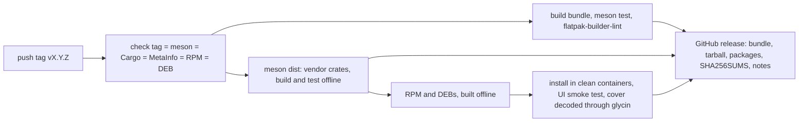

# Releasing

GitHub Releases are the release channel. A `v*` tag runs `.github/workflows/release.yml`, which builds the stable
Flatpak from `build-aux/flatpak/io.github.tim_van_oudheusden.pindu-launcher.yml`, a source tarball with the crates
vendored (`meson dist`), and from that tarball an RPM for Fedora 45 and `.deb`s for Debian testing and Ubuntu 26.10.
The bundle and the packages are built for x86_64 and aarch64, each natively on a GitHub runner of that architecture.
It publishes them with checksums and notes. Nothing is uploaded by hand.



## Cut a release

1. **Open an issue** ("Release X.Y.Z") in the M5 milestone, or whichever one is current, and branch
   `release/<issue>-vX.Y.Z` off an up-to-date `main`.
2. **Bump the version** in `meson.build` (`project(version:)`), `Cargo.toml` (`[workspace.package] version`) and
   `build-aux/rpm/pindu-launcher.spec` (`Version:`, plus a `%changelog` entry), add an entry at the top of
   `build-aux/deb/debian/changelog` (`dch -v X.Y.Z-1`, or by hand), then run `cargo check` so `Cargo.lock` follows.
3. **Write the notes** as a new `<release version="X.Y.Z" date="YYYY-MM-DD">` at the top of `<releases>` in
   `data/io.github.tim_van_oudheusden.pindu-launcher.metainfo.xml.in`: one `<p>` and a `<ul>` of user-visible changes
   since the last tag (`git log vPREVIOUS..`). The same text becomes the release notes on GitHub and in software
   centres, so write it for users. Preview it with `build-aux/release-notes.py X.Y.Z`.
4. **Refresh the translation template**, which carries the MetaInfo strings: `meson compile -C _build
   pindu-launcher-pot`. CI's `po/check-pot.sh` fails otherwise.
5. **Check** with `meson test -C _build`: its `versions` test fails while the versions disagree.
6. **Land it** through a pull request as usual.
7. **Tag the merge commit** on `main` and push the tag:

   ```sh
   git switch main && git pull
   git tag -a vX.Y.Z -m "Pindu launcher X.Y.Z"
   git push origin vX.Y.Z
   ```

8. **Watch the [Release workflow](https://github.com/Tim-van-Oudheusden/pindu-launcher/actions/workflows/release.yml)**.
   When it is green, the [release](https://github.com/Tim-van-Oudheusden/pindu-launcher/releases) has, for each
   architecture, `pindu-launcher-X.Y.Z-<x86_64|aarch64>.flatpak`, `pindu-launcher-X.Y.Z-1.fc45.<x86_64|aarch64>.rpm`,
   `pindu-launcher-X.Y.Z-debian-testing-<amd64|arm64>.deb` and `pindu-launcher-X.Y.Z-ubuntu-26.10-<amd64|arm64>.deb`,
   plus `pindu-launcher-X.Y.Z.tar.xz` and `SHA256SUMS`. Install the bundle (the notes say how), start it, and check
   that it opens and imports a library.

The native packages target the distros that ship GTK 4.24 and libadwaita 1.10 (#232). When a new Fedora, Debian or
Ubuntu release qualifies, add it to the `packages` and `packages-smoke` matrices in `packaging.yml` and `release.yml`
and to the table in `build-aux/release-notes.py`.

## Soak a pre-release

A final release first soaks as a pre-release on real machines. Pindu OS follows only final releases, so nothing
reaches its users before the soak ends.

1. **Cut a pre-release** with the steps above, under the same "Release X.Y.Z" issue, with the version written the way
   each tool sorts a pre-release below the final version (`build-aux/check-version.sh` checks all of them):

   | Where | First pre-release of 0.5.0 |
   | --- | --- |
   | `meson.build`, `Cargo.toml`, the tag | `0.5.0-rc.1`, tag `v0.5.0-rc.1` |
   | RPM spec `Version:` and `%changelog` | `0.5.0~rc1`, changelog entry `0.5.0~rc1-1` |
   | Debian changelog | `0.5.0~rc1-1` (`dch -v 0.5.0~rc1-1`) |
   | MetaInfo | `<release version="0.5.0~rc1" type="development" date="YYYY-MM-DD">` |

   The Release workflow publishes a `vX.Y.Z-rc.N` tag as a GitHub pre-release that never becomes "latest". Its files
   are named after the tag (`pindu-launcher-0.5.0-rc.1-x86_64.flatpak`, `pindu-launcher-0.5.0-rc.1-1.fc45.x86_64.rpm`
   and so on), because GitHub renames files with a `~`; the packages inside are `0.5.0~rc1`, which `dnf` and `apt`
   upgrade to `0.5.0`.
2. **Run the hardware checklist** on the pre-release's files, on one real machine, and record the result on the
   "Release X.Y.Z" issue.
3. **Wait a few days** while the pre-release runs on real machines. A bug that needs a fix goes through a pull request
   and a new pre-release (`rc.2`), whose soak starts again with step 2.
4. **Tag the final version** once the soak passes, with steps 2 to 8 above: a pull request sets `X.Y.Z` in
   `meson.build`, `Cargo.toml` and the RPM spec, adds `X.Y.Z-1` entries to the RPM and Debian changelogs, and turns the
   MetaInfo's pre-release `<release>` into `<release version="X.Y.Z" date="YYYY-MM-DD">` without `type`; then tag its
   merge commit `vX.Y.Z`. The final must ship the code that soaked: if anything but that version bump has landed on
   `main` since the pre-release, cut another pre-release instead and soak that.

## When something goes wrong

- **The version check fails:** the tag does not match the tree. Delete the tag (`git push origin :vX.Y.Z` and
  `git tag -d vX.Y.Z`), fix the versions through a pull request, and tag again.
- **The build, a test or the lint fails:** nothing is published. Fix it through a pull request and release a new patch
  version; a published tag is never moved.
- **The publish step fails** (a network or permissions error): run the Release workflow by hand from the Actions tab
  with the tag as input. It rebuilds the tag and replaces the files of an existing release.
- **A published release is broken:** mark it as a pre-release or delete it on GitHub, and release a fixed patch
  version. Keep the tag, so the version is never reused.
