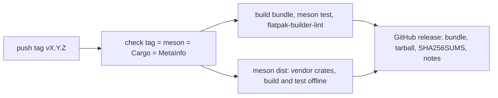

# Releasing

GitHub Releases are the release channel. A `v*` tag runs `.github/workflows/release.yml`, which builds the stable
Flatpak from `build-aux/flatpak/io.github.tim_van_oudheusden.pindu-launcher.yml` and a source tarball with the crates
vendored (`meson dist`), and publishes both with checksums and notes. Nothing is uploaded by hand.



## Cut a release

1. **Open an issue** ("Release X.Y.Z") in the M5 milestone, or whichever one is current, and branch
   `release/<issue>-vX.Y.Z` off an up-to-date `main`.
2. **Bump the version** in `meson.build` (`project(version:)`) and `Cargo.toml` (`[workspace.package] version`), then
   run `cargo check` so `Cargo.lock` follows.
3. **Write the notes** as a new `<release version="X.Y.Z" date="YYYY-MM-DD">` at the top of `<releases>` in
   `data/io.github.tim_van_oudheusden.pindu-launcher.metainfo.xml.in`: one `<p>` and a `<ul>` of user-visible changes
   since the last tag (`git log vPREVIOUS..`). The same text becomes the release notes on GitHub and in software
   centres, so write it for users. Preview it with `build-aux/release-notes.py X.Y.Z`.
4. **Refresh the translation template**, which carries the MetaInfo strings: `meson compile -C _build
   pindu-launcher-pot`. CI's `po/check-pot.sh` fails otherwise.
5. **Check** with `meson test -C _build`: its `versions` test fails while the three versions disagree.
6. **Land it** through a pull request as usual.
7. **Tag the merge commit** on `main` and push the tag:

   ```sh
   git switch main && git pull
   git tag -a vX.Y.Z -m "Pindu launcher X.Y.Z"
   git push origin vX.Y.Z
   ```

8. **Watch the [Release workflow](https://github.com/Tim-van-Oudheusden/pindu-launcher/actions/workflows/release.yml)**.
   When it is green, the [release](https://github.com/Tim-van-Oudheusden/pindu-launcher/releases) has
   `pindu-launcher-X.Y.Z-x86_64.flatpak`, `pindu-launcher-X.Y.Z.tar.xz` and `SHA256SUMS`. Install the bundle (the
   notes say how), start it, and check that it opens and imports a library.

## When something goes wrong

- **The version check fails:** the tag does not match the tree. Delete the tag (`git push origin :vX.Y.Z` and
  `git tag -d vX.Y.Z`), fix the versions through a pull request, and tag again.
- **The build, a test or the lint fails:** nothing is published. Fix it through a pull request and release a new patch
  version; a published tag is never moved.
- **The publish step fails** (a network or permissions error): run the Release workflow by hand from the Actions tab
  with the tag as input. It rebuilds the tag and replaces the files of an existing release.
- **A published release is broken:** mark it as a pre-release or delete it on GitHub, and release a fixed patch
  version. Keep the tag, so the version is never reused.
