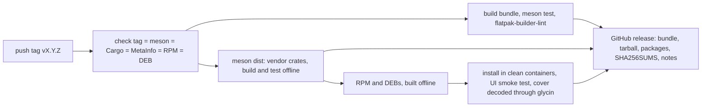

# Releasing

GitHub Releases are the release channel. A `v*` tag runs `.github/workflows/release.yml`, which builds the stable
Flatpak from `build-aux/flatpak/io.github.tim_van_oudheusden.pindu-launcher.yml`, a source tarball with the crates
vendored (`meson dist`), and from that tarball an RPM for Fedora 45 and `.deb`s for Debian testing and Ubuntu 26.10.
The bundle and the packages are built for x86_64 and aarch64, each natively on a GitHub runner of that architecture.
It publishes them with checksums and notes. Nothing is uploaded by hand.



## Cut a release

1. **Open an issue** ("Release X.Y.Z") in the M5 milestone, or whichever one is current, and branch
   `release/<issue>-vX.Y.Z` off an up-to-date `main`.
2. **Bump the version** in `meson.build` (`project(version:)`), `Cargo.toml` (`[workspace.package] version`) and
   `build-aux/rpm/pindu-launcher.spec` (`Version:`, plus a `%changelog` entry), add an entry at the top of
   `build-aux/deb/debian/changelog` (`dch -v X.Y.Z-1`, or by hand), then run `cargo check` so `Cargo.lock` follows.
3. **Write the notes** as a new `<release version="X.Y.Z" date="YYYY-MM-DD">` at the top of `<releases>` in
   `data/io.github.tim_van_oudheusden.pindu-launcher.metainfo.xml.in`: one `<p>` and a `<ul>` of user-visible changes
   since the last tag (`git log vPREVIOUS..`). The same text becomes the release notes on GitHub and in software
   centres, so write it for users. Preview it with `build-aux/release-notes.py X.Y.Z`.
4. **Refresh the translation template**, which carries the MetaInfo strings: `meson compile -C _build
   pindu-launcher-pot`. CI's `po/check-pot.sh` fails otherwise.
5. **Check** with `meson test -C _build`: its `versions` test fails while the versions disagree.
6. **Land it** through a pull request as usual.
7. **Tag the merge commit** on `main` and push the tag:

   ```sh
   git switch main && git pull
   git tag -a vX.Y.Z -m "Pindu launcher X.Y.Z"
   git push origin vX.Y.Z
   ```

8. **Watch the [Release workflow](https://github.com/Tim-van-Oudheusden/pindu-launcher/actions/workflows/release.yml)**.
   When it is green, the [release](https://github.com/Tim-van-Oudheusden/pindu-launcher/releases) has, for each
   architecture, `pindu-launcher-X.Y.Z-<x86_64|aarch64>.flatpak`, `pindu-launcher-X.Y.Z-1.fc45.<x86_64|aarch64>.rpm`,
   `pindu-launcher-X.Y.Z-debian-testing-<amd64|arm64>.deb` and `pindu-launcher-X.Y.Z-ubuntu-26.10-<amd64|arm64>.deb`,
   plus `pindu-launcher-X.Y.Z.tar.xz` and `SHA256SUMS`. Install the bundle (the notes say how), start it, and check
   that it opens and imports a library.

The native packages target the distros that ship GTK 4.24 and libadwaita 1.10 (#232). When a new Fedora, Debian or
Ubuntu release qualifies, add it to the `packages` and `packages-smoke` matrices in `packaging.yml` and `release.yml`
and to the table in `build-aux/release-notes.py`.

## Distribution recipes

COPR, the AUR and nixpkgs build the release tarball, `pindu-launcher-X.Y.Z.tar.xz`, whose crates are vendored, so
each builds offline (#382). The tarball's checksum exists only once the release is published, so the AUR and nixpkgs
recipes are bumped after step 8, through a pull request of their own; `meson test`'s `versions` check leaves them out.
Take the checksum from the release's `SHA256SUMS`.

- **COPR** (`.copr/Makefile`, the make_srpm method): nothing to bump. It builds `build-aux/rpm/pindu-launcher.spec`,
  already bumped in step 2, downloads the spec's `Source0` and checks it against the release's `SHA256SUMS`, so start
  the COPR build only once the release is published. Try it in a `fedora:45` container with
  `make -f .copr/Makefile srpm outdir=/tmp/srpm`, then `dnf builddep` and `rpmbuild --rebuild` on the `.src.rpm`.
  The COPR project builds for the Fedora releases that ship GTK 4.24 and libadwaita 1.10: Fedora 45 and rawhide,
  x86_64 and aarch64.
- **AUR** (`build-aux/aur/PKGBUILD`): set `pkgver`, reset `pkgrel=1` and set `sha256sums`, or run `updpkgsums`. Then
  regenerate the metadata with `makepkg --printsrcinfo > .SRCINFO`, both on Arch, and try it with `makepkg -s` as a
  non-root user in an `archlinux` container. The AUR repository gets these two files at its root.
- **nixpkgs** (`build-aux/nix/package.nix`): set `version` and the `src` hash, the tarball's SHA-256 in SRI form:
  `nix hash convert --hash-algo sha256 --to sri <sha256>`. There is no `cargoHash`: the build uses the tarball's
  vendored crates. Try it in a `nixos/nix` container with
  `nix-build -E 'with import <nixpkgs> { }; callPackage ./build-aux/nix/package.nix { }'`.

## When something goes wrong

- **The version check fails:** the tag does not match the tree. Delete the tag (`git push origin :vX.Y.Z` and
  `git tag -d vX.Y.Z`), fix the versions through a pull request, and tag again.
- **The build, a test or the lint fails:** nothing is published. Fix it through a pull request and release a new patch
  version; a published tag is never moved.
- **The publish step fails** (a network or permissions error): run the Release workflow by hand from the Actions tab
  with the tag as input. It rebuilds the tag and replaces the files of an existing release.
- **A published release is broken:** mark it as a pre-release or delete it on GitHub, and release a fixed patch
  version. Keep the tag, so the version is never reused.
