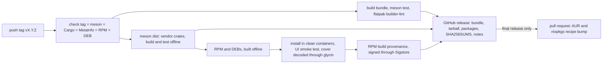

# Releasing

GitHub Releases are the release channel. A `v*` tag runs `.github/workflows/release.yml`, which builds the stable
Flatpak from `build-aux/flatpak/io.github.tim_van_oudheusden.pindu-launcher.yml`, a source tarball with the crates
vendored (`meson dist`), and from that tarball an RPM for Fedora 45 and `.deb`s for Debian testing and Ubuntu 26.10.
The bundle and the packages are built for x86_64 and aarch64, each natively on a GitHub runner of that architecture.
It publishes them with checksums and notes, and signs build provenance for the RPMs. Nothing is uploaded by hand.



## Cut a release

1. **Open an issue** ("Release X.Y.Z") from the [Release issue form](../.github/ISSUE_TEMPLATE/release.yml), which
   carries the [hardware checklist](#hardware-checklist), in the M5 milestone, or whichever one is current, and branch
   `release/<issue>-vX.Y.Z` off an up-to-date `main`.
2. **Bump the version** in `meson.build` (`project(version:)`), `Cargo.toml` (`[workspace.package] version`) and
   `build-aux/rpm/pindu-launcher.spec` (`Version:`, plus a `%changelog` entry), add an entry at the top of
   `build-aux/deb/debian/changelog` (`dch -v X.Y.Z-1`, or by hand), then run `cargo check` so `Cargo.lock` follows.
3. **Write the notes** as a new `<release version="X.Y.Z" date="YYYY-MM-DD">` at the top of `<releases>` in
   `data/io.github.tim_van_oudheusden.pindu-launcher.metainfo.xml.in`: one `<p>` and a `<ul>` of user-visible changes
   since the last tag (`git log vPREVIOUS..`). The same text becomes the release notes on GitHub and in software
   centres, so write it for users. Preview it with `build-aux/release-notes.py X.Y.Z`. When the external importer
   [changelog](external-importers.md#changelog) has "Unreleased" entries, replace "Unreleased" with X.Y.Z there and give
   the notes a sentence for helper authors, as its [compatibility policy](external-importers.md#announcing-a-change)
   asks.
4. **Refresh the translation template**, which carries the MetaInfo strings: `meson compile -C _build
   pindu-launcher-pot`. CI's `po/check-pot.sh` fails otherwise.
5. **Check** with `meson test -C _build`: its `versions` test fails while the versions disagree.
6. **Land it** through a pull request as usual.
7. **Tag the merge commit** on `main` and push the tag:

   ```sh
   git switch main && git pull
   git tag -a vX.Y.Z -m "Pindu launcher X.Y.Z"
   git push origin vX.Y.Z
   ```

8. **Watch the [Release workflow](https://github.com/Tim-van-Oudheusden/pindu-launcher/actions/workflows/release.yml)**.
   When it is green, the [release](https://github.com/Tim-van-Oudheusden/pindu-launcher/releases) has, for each
   architecture, `pindu-launcher-X.Y.Z-<x86_64|aarch64>.flatpak`, `pindu-launcher-X.Y.Z-1.fc45.<x86_64|aarch64>.rpm`,
   `pindu-launcher-X.Y.Z-debian-testing-<amd64|arm64>.deb` and `pindu-launcher-X.Y.Z-ubuntu-26.10-<amd64|arm64>.deb`,
   plus `pindu-launcher-X.Y.Z.tar.xz` and `SHA256SUMS`. Install the bundle (the notes say how), start it, and check
   that it opens and imports a library. Check an RPM's [build provenance](#verify-an-rpms-build-provenance).
9. **Run the [hardware checklist](#hardware-checklist)** on the release's files, on one real machine, and record the
   result on the "Release X.Y.Z" issue. Run it on a pre-release, then tag the final version, so a failed check never
   reaches a final release; a [fast final release](#fast-final-release) runs it on the final's files instead.
10. **Close the milestones this release finished**, for a final release only. For each milestone with no open issues
    left, check its gate, held in the milestone's description, against the release's files and record the result on
    the "Release X.Y.Z" issue. Close the milestone once its gate passes; one whose gate does not pass yet stays open,
    with an issue in it for what is missing. The README's Status section and `CONTRIBUTING.md` send readers to the
    milestones page as the roadmap, so a finished milestone left open there reads as unfinished work (#676).

The native packages target the distros that ship GTK 4.24 and libadwaita 1.10 (#232). When a new Fedora, Debian or
Ubuntu release qualifies, add it to the `packages` and `packages-smoke` matrices in `packaging.yml` and `release.yml`
and to the table in `build-aux/release-notes.py`.

## Soak a pre-release

A final release first soaks as a pre-release on real machines. Pindu OS follows only final releases, so nothing
reaches its users before the soak ends.

1. **Cut a pre-release** with the steps above, under the same "Release X.Y.Z" issue, with the version written the way
   each tool sorts a pre-release below the final version (`build-aux/check-version.sh` checks all of them):

   | Where | First pre-release of 0.5.0 |
   | --- | --- |
   | `meson.build`, `Cargo.toml`, the tag | `0.5.0-rc.1`, tag `v0.5.0-rc.1` |
   | RPM spec `Version:` and `%changelog` | `0.5.0~rc1`, changelog entry `0.5.0~rc1-1` |
   | Debian changelog | `0.5.0~rc1-1` (`dch -v 0.5.0~rc1-1`) |
   | MetaInfo | `<release version="0.5.0~rc1" type="development" date="YYYY-MM-DD">` |

   The Release workflow publishes a `vX.Y.Z-rc.N` tag as a GitHub pre-release that never becomes "latest". Its files
   are named after the tag (`pindu-launcher-0.5.0-rc.1-x86_64.flatpak`, `pindu-launcher-0.5.0-rc.1-1.fc45.x86_64.rpm`
   and so on), because GitHub renames files with a `~`; the packages inside are `0.5.0~rc1`, which `dnf` and `apt`
   upgrade to `0.5.0`.
2. **Run the hardware checklist** on the pre-release's files, on one real machine, and record the result on the
   "Release X.Y.Z" issue.
3. **Wait a few days** while the pre-release runs on real machines. A bug that needs a fix goes through a pull request
   and a new pre-release (`rc.2`), whose soak starts again with step 2.
4. **Tag the final version** once the soak passes, with steps 2 to 8 above: a pull request sets `X.Y.Z` in
   `meson.build`, `Cargo.toml` and the RPM spec, adds `X.Y.Z-1` entries to the RPM and Debian changelogs, and turns the
   MetaInfo's pre-release `<release>` into `<release version="X.Y.Z" date="YYYY-MM-DD">` without `type`; then tag its
   merge commit `vX.Y.Z`. The final must ship the code that soaked: if anything but that version bump has landed on
   `main` since the pre-release, cut another pre-release instead and soak that.

## Fast final release

The maintainer may cut a final release straight away, without the pre-release and soak above, when waiting buys
little: a small patch, or fixes the maintainer has already run from a development build of `main`. Only the maintainer
makes that call, and the "Release X.Y.Z" issue says so in its **Notes**, with what the release ships. 0.5.1 went out
this way (#497): no `rc` tag, only `v0.5.1`. 0.5.0 (#417) soaked as `rc.1` to `rc.4`, then the maintainer waived the
extra pre-release that step 4 above asks for when more than the version bump has landed since the last one.

A fast release may skip:

- **The pre-release**: no `vX.Y.Z-rc.N` tag; steps 1 to 8 of [Cut a release](#cut-a-release) run once, for `X.Y.Z`.
- **The soak**: the days on real machines before the final tag, and so the rule that the final ships exactly the code
  that soaked.

It never skips:

- **The hardware checklist and its recorded pass.** It runs on the final release's own files instead, and the
  maintainer adds `hardware-check:passed` to the issue only when every check passes on them. Pindu OS follows final
  releases but promotes a launcher from `:testing` to `:stable` only on that label, so until it is added, `:stable`
  keeps the previous launcher. A failed check leaves the label off and the fix ships as a new patch version, whose
  checklist runs again; the broken version never reaches `:stable`.
- **The release pull request and the tag**: the version bump, the MetaInfo notes, the refreshed translation template
  and `meson test`'s `versions` check land through a pull request, and a `vX.Y.Z` tag on its merge commit publishes.
- **The Release workflow**: the version check, the Flatpak build with `meson test` and `flatpak-builder-lint`, the
  offline builds from the source tarball, and the install and UI smoke tests in clean containers. Nothing is
  published unless all of them pass, and nothing is uploaded by hand.
- **The [distribution recipes](#distribution-recipes)**, bumped after the final is published, as for any final.

## Distribution recipes

COPR, the AUR and nixpkgs build the release tarball, `pindu-launcher-X.Y.Z.tar.xz`, whose crates are vendored, so
each builds offline (#382). They follow final releases only, as Pindu OS does: a `vX.Y.Z-rc.N` pre-release is never
built or bumped there, so their users only get a version once it is final. The tarball's checksum exists only
once the final release is published, so the AUR and nixpkgs recipes are bumped after step 8 of the final release,
through a pull request of their own; `meson test`'s `versions` check leaves them out.

**The Release workflow opens that pull request by itself.** Once a final release is published, its `recipes` job runs
`scripts/recipe-bump.py`, which takes the tarball's checksum from the release's `SHA256SUMS` and sets the AUR and
nixpkgs lines below, then pushes `chore/recipes-X.Y.Z` and opens the pull request, which refers to the "Release X.Y.Z"
issue. A pre-release skips the job, and a rerun does nothing once the pull request is open or `main`'s recipes build
the version. A pull request opened with the workflow's token starts no workflow: **close and reopen it** to run the
checks, try the recipes as below, and merge it (it is high risk, `build-aux/**`). Then copy the PKGBUILD and a fresh
`.SRCINFO` to the AUR repository. When the repository does not allow Actions to create pull requests (Settings,
Actions, General, "Allow GitHub Actions to create and approve pull requests"), `gh pr create` is refused: the job still
ends green after the push, with a warning, and its run summary links the compare page of `chore/recipes-X.Y.Z` and
holds the pull request's body, so a person opens the pull request there and carries on as above. When the job fails, run the script by hand:
`python3 scripts/recipe-bump.py X.Y.Z SHA256SUMS`, with the release's `SHA256SUMS` downloaded.

- **COPR** (`.copr/Makefile`, the make_srpm method): nothing to bump. It builds `build-aux/rpm/pindu-launcher.spec`,
  already bumped in step 2, downloads the spec's `Source0` and checks it against the release's `SHA256SUMS`, so start
  the COPR build only once the final release is published. While `main`'s spec holds a pre-release version
  (`X.Y.Z~rcN`), `make srpm` refuses to run: the tarball of tag `vX.Y.Z-rc.N` is not where `Source0` points, and COPR
  ships final releases only. Try it in a `fedora:45` container with
  `make -f .copr/Makefile srpm outdir=/tmp/srpm`, then `dnf builddep` and `rpmbuild --rebuild` on the `.src.rpm`.
  The COPR project builds for the Fedora releases that ship GTK 4.24 and libadwaita 1.10: Fedora 45 and rawhide,
  x86_64 and aarch64.
- **AUR** (`build-aux/aur/PKGBUILD`): set `pkgver`, reset `pkgrel=1` and set `sha256sums`, or run `updpkgsums`. Then
  regenerate the metadata with `makepkg --printsrcinfo > .SRCINFO`, both on Arch, and try it with `makepkg -s` as a
  non-root user in an `archlinux` container. The AUR repository gets these two files at its root.
- **nixpkgs** (`build-aux/nix/package.nix`): set `version` and the `src` hash, the tarball's SHA-256 in SRI form:
  `nix hash convert --hash-algo sha256 --to sri <sha256>`. There is no `cargoHash`: the build uses the tarball's
  vendored crates. Try it in a `nixos/nix` container with
  `nix-build -E 'with import <nixpkgs> { }; callPackage ./build-aux/nix/package.nix { }'`.

## Verify an RPM's build provenance

The Release workflow's `provenance` job signs a [build provenance
attestation](https://docs.github.com/en/actions/security-for-github-actions/using-artifact-attestations) for each RPM
with `actions/attest-build-provenance`, before the release is published. It records which workflow run built the file,
from which commit, and is signed through Sigstore with the run's identity, so no one can forge it without this
repository's workflow. Pindu OS asks for it, so it can check a release RPM before it installs one. Check one with the
GitHub CLI:

```sh
gh release download vX.Y.Z -R Tim-van-Oudheusden/pindu-launcher -p 'pindu-launcher-*.fc45.x86_64.rpm'
gh attestation verify pindu-launcher-X.Y.Z-1.fc45.x86_64.rpm -R Tim-van-Oudheusden/pindu-launcher \
  --signer-workflow Tim-van-Oudheusden/pindu-launcher/.github/workflows/release.yml
```

It prints `Verification succeeded!` and the workflow run that built the file; a changed file, or one built anywhere
else, fails. A rerun of the workflow by hand signs the rebuilt files again; that attestation names the branch the run
was started from as its source, and the tag is the run's input.

## When something goes wrong

- **The version check fails:** the tag does not match the tree. Delete the tag (`git push origin :vX.Y.Z` and
  `git tag -d vX.Y.Z`), fix the versions through a pull request, and tag again.
- **The build, a test or the lint fails:** nothing is published. Fix it through a pull request and release a new patch
  version; a published tag is never moved.
- **The publish step fails** (a network or permissions error): run the Release workflow by hand from the Actions tab
  with the tag as input. It rebuilds the tag and replaces the files of an existing release.
- **A published release is broken:** mark it as a pre-release on GitHub, so it is no longer "latest", and release a
  fixed patch version. Keep the tag, so the version is never reused, and keep the release and its files: never delete
  it. COPR's `Source0` and `SHA256SUMS`, the AUR `source` and the nixpkgs `src` all download from the release, and so
  does the [build provenance](#verify-an-rpms-build-provenance) check, so a deleted release stops every recipe
  building until the fixed version is bumped. Then:
  - remove `hardware-check:passed` from the "Release X.Y.Z" issue, so Pindu OS does not promote the broken version
    to `:stable`;
  - close the `chore/recipes-X.Y.Z` pull request if it is still open, and start no COPR build for the version;
  - let the fixed version's own [recipe bump](#distribution-recipes) replace it downstream.

## Hardware checklist

Fullscreen mode's system panel, controllers, gamescope and Proton only fail on real hardware, so every release runs
this checklist once, by hand, on one real machine. Run it on the pre-release before the final tag, or on the final's
files for a [fast final release](#fast-final-release); Pindu OS waits for a recorded pass before it promotes the new
launcher from `:testing` to `:stable` ([pindu-os#30](https://github.com/Tim-van-Oudheusden/pindu-os/issues/30)).

**The machine** runs Pindu OS with the build under test installed, because the system panel's Network, Bluetooth,
Power and System Update sections only show there (see [System panel](system-panel.md)). It needs a Bluetooth adapter,
Wi-Fi, a Bluetooth controller, a Steam library with one native game and one Windows game set to run through Proton, one
game in another launcher (Heroic, Lutris, Bottles or itch), one game installed as an app, and a Windows game to add by
hand. [Hardware](hardware.md) lists the machines in the published set, the desktop window's checks that run beside
this list, and the matrix of hardware reports from other machines.

| Check | Passes when |
| --- | --- |
| Fullscreen mode in gamescope | The launcher starts fullscreen in the gamescope session, the controller drives it, a game takes the focus and the launcher gets it back when the game quits |
| Controller over Bluetooth | **Quick Access → Bluetooth** pairs the controller, which then moves through the library, opens a game's page and goes back |
| Wi-Fi with the on-screen keyboard | **Quick Access → Network** joins a WPA2 network, with the passphrase typed on the on-screen keyboard with the controller |
| Suspend and resume | **Power → Suspend** puts the machine to sleep; after waking, the launcher, the controller and the network work again |
| Steam game | A native Steam game starts from the launcher, and its playtime counts once it quits |
| Proton game | A Windows game through Proton starts from the launcher, and its playtime counts once it quits |
| Game from another launcher | The game in the other launcher starts through that launcher, and the game installed as an app starts on the host (in the Flatpak, once [host access](../README.md#starting-games-on-the-host) is granted) |
| Game added by hand | The Windows game, added with **Add a Game**, starts through Proton, and its playtime counts once it quits |
| System Update | **Quick Access → System Update** shows the installed version, and the update state and actions it offers work |
| Leaving Steam Big Picture | In Steam mode, with Big Picture opened from Home's tile and a download running: the notice shows Guide + Y and "Back to Pindu" over Big Picture for a few seconds; Guide + Y brings the launcher back with the controller, and so does Steam's Switch to Desktop; the download goes on, and the tile shows Steam's window again at once. With a Steam game started from Big Picture, leaving shows its Playing Now card, whose Return brings it back |
| Rollback after a migration | On Pindu OS, update to the build under test so it migrates a library from the previous release, then roll back to the previous release (**Quick Access → System Update → Roll Back**). The older launcher says **Library From a Newer Version** and that nothing was changed, `library.db` is unchanged, and **Start From Kept Copy** opens the library as it was before the update, with the newer library kept aside as `library.db.v<N>.newer`. A release whose library format did not change passes with a note saying so |
| Steam's first start | On a user account that has never run Steam, Home's **Big Picture** shows **Setting Up Steam** with the download moving until Steam's sign-in window is there, Steam's own update windows do not cover it in a `gamescope --steam` session, and **Cancel** returns to Home |

**Record it on the "Release X.Y.Z" issue**, which the [Release issue form](../.github/ISSUE_TEMPLATE/release.yml)
creates with the checklist in it. The title is exactly `Release X.Y.Z`, the final version without `v` or `-rc.N`, so
one issue holds the checks for every pre-release of that version:

1. Fill in **Hardware tested** (the machine, the Pindu OS image, the controller, the Wi-Fi network) and **Build tested**
   (the tag and the file installed, for example `v0.5.0-rc.1` and `pindu-launcher-0.5.0-rc.1-1.fc45.x86_64.rpm`).
2. Tick each check that passes. Comment on a check that fails, with what happened, and file a bug for it.
3. When every check is ticked for one build, the maintainer adds the label **`hardware-check:passed`** to the issue.
   That label on that issue is the recorded pass; nothing else counts. The issue may be open or closed.

A failed check leaves the label off. The fix ships in a new pre-release, and the checklist runs again on it: untick the
boxes and update **Build tested**. If the label was already added and a later build is the one that ships, remove the
label until the new build passes.

Pindu OS looks the pass up with:

```sh
gh issue list -R Tim-van-Oudheusden/pindu-launcher --state all --label hardware-check:passed \
  --search '"Release X.Y.Z" in:title' --json title,url --jq '.[] | select(.title == "Release X.Y.Z") | .url'
```
